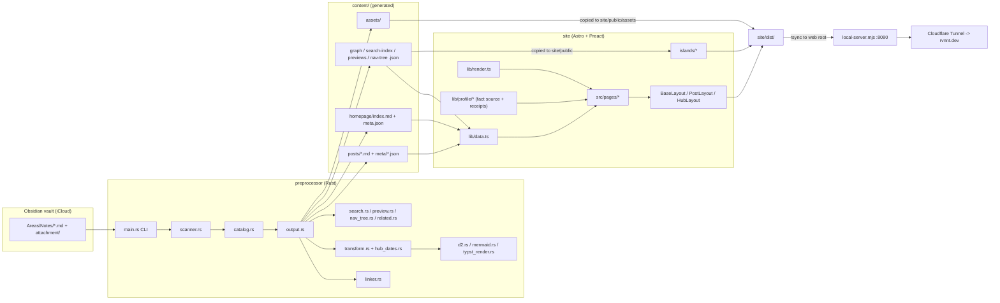
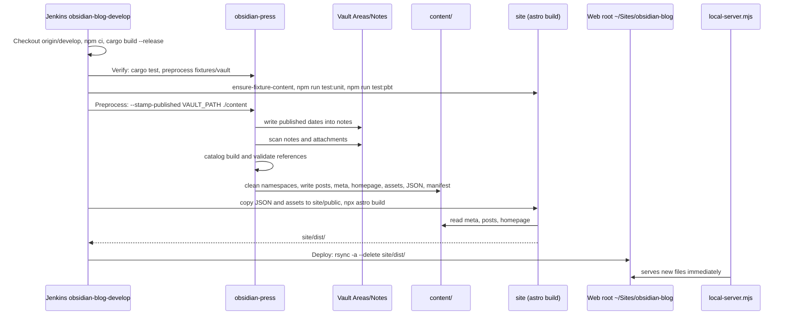
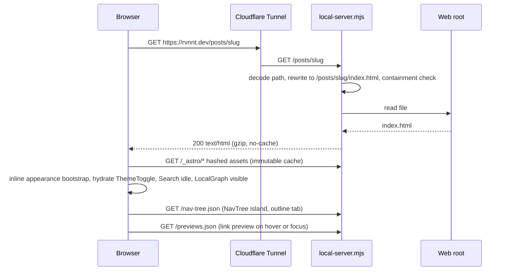
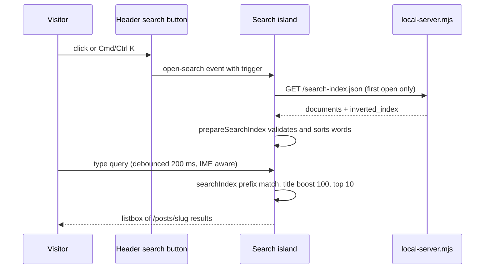
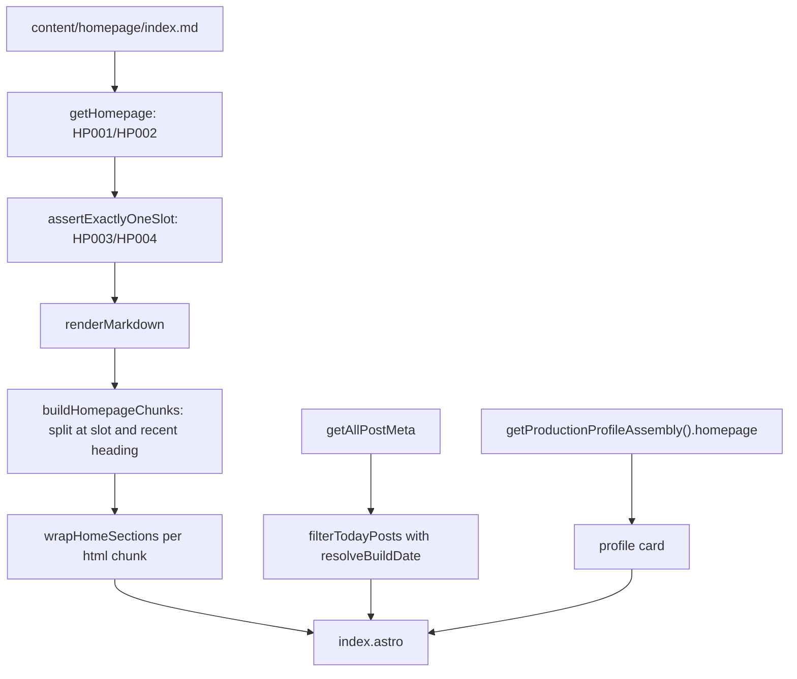
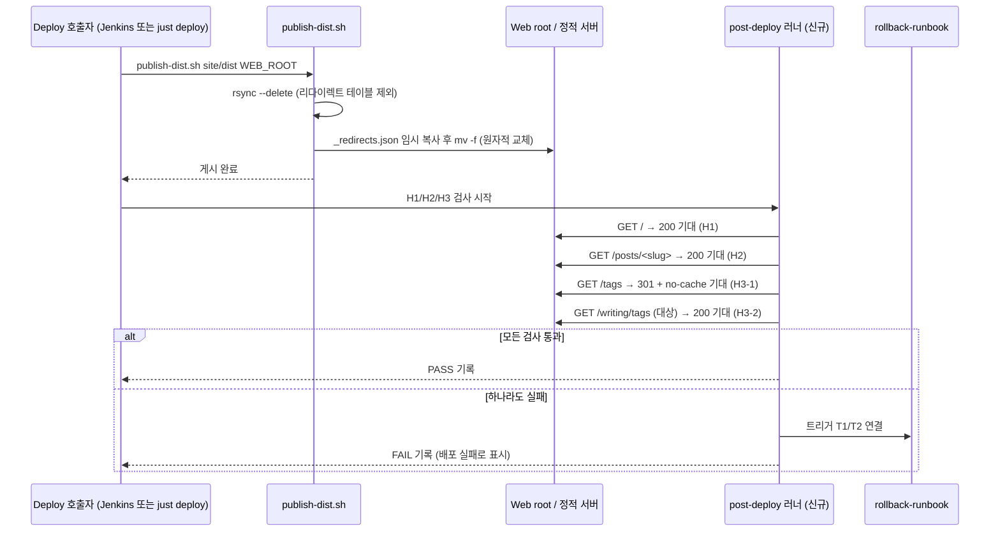

# Architecture

## Architecture Analysis

### System Overview

A two-stage static publishing system on one machine:

1. **Preprocessor** (`preprocessor/`, Rust CLI `obsidian-press`): reads one vault folder, validates publication scope, transforms Obsidian syntax into Markdown with embedded HTML, renders diagrams through external CLIs, and writes a self-contained `content/` tree plus global JSON indexes.
2. **Site** (`site/`, Astro 7 static output + Preact islands): reads `content/` from the filesystem at build time, renders Markdown through its own unified pipeline (`src/lib/render.ts`), and emits `site/dist/`. Four JSON indexes are copied into `site/public/` and fetched by islands at run time.
3. **Serving**: `rsync` copies `site/dist/` to `~/Sites/obsidian-blog`; `site/scripts/local-server.mjs` (launchd `dev.rvnnt.blog`, port 8080) serves it; Cloudflare Tunnel `obsidian-blog` publishes it as https://rvnnt.dev.
4. **Automation**: the Jenkins job `obsidian-blog-develop` runs the whole chain nightly from `origin/develop`; `Justfile` holds the same steps for local use.

The profile domain (`site/src/lib/profile/`, `site/scripts/profile/`) is a separate, build-time-only subsystem inside the site, fed by a TypeScript fact source and sealed approval records rather than by the vault.

### Architectural Style

Batch pipeline + static site generator (a "pipes and filters" monolith split across two languages). Evidence: the preprocessor's ordered passes in `main.rs` (scan → catalog → validate references → write output) and `output.rs` (link → transform → global artifacts → manifest); the site has `output: 'static'` and no server runtime beyond a static file server. The two halves communicate only through files (`content/` and `site/public/*.json`).

### Component Relationships

Text fallback: the vault's `Areas/Notes` feeds the preprocessor CLI. The scanner builds an index, the publication catalog splits it into one homepage and posts, and the output writer runs the linker, the transform pipeline (which calls the diagram renderers) and the global index builders. They write `content/`: post Markdown and metadata, the homepage artifact, four JSON indexes and assets. The site's data module reads `content/`; pages render through the unified renderer and layouts; profile pages read the approved profile instead. The JSON indexes and assets are also copied into `site/public/` for islands. The build output is rsynced to the web root, served by the local Node server and published through the Cloudflare Tunnel.

### Data Flow

1. **Scan** (`scanner.rs`): walk the vault (skip dot-entries and `Drafts`), parse YAML frontmatter (dates kept as strings), slug from the file name, headings and `^block-id`s indexed, `updated` from one batched `git log`, `created` from frontmatter or file birth time. Sorted by slug.
2. **Catalog** (`catalog.rs`): parse `visibility`, require exactly one homepage, build a `full()` view (for link resolution) and a `posts_only()` view (for every discovery derivation); then reject transclusions of the homepage.
3. **Write** (`output.rs`): clean managed namespaces (`posts`, `meta`, `assets`, `homepage`, the five JSON files), resolve links on the posts-only view, transform each post against the full view (homepage links become `/`), copy referenced images from the nearest `attachment/`, compute reading time, related posts and metadata, write the homepage artifact, the global JSON files and a sorted `manifest.json`.
4. **Copy**: `just preprocess` / Jenkins copy the four JSON files and `assets/` into `site/public/`.
5. **Build** (`site/`): `getStaticPaths` from `content/meta/*.json`; Markdown rendered by `render.ts` (remark → rehype-raw → Shiki → slug → image sizing and captions → KaTeX); the homepage composed from the homepage artifact, the profile assembly and today's posts; profile pages from `getProductionProfileAssembly()`.
6. **Serve**: static files only; the browser fetches `/search-index.json`, `/graph.json`, `/nav-tree.json` and `/previews.json` on demand.

### Key Design Decisions

- **File contract between halves**: no shared code between Rust and TypeScript; `site/src/lib/types.ts` mirrors the Rust JSON shapes by hand.
- **Custom renderer**: Markdown is rendered by `render.ts`, not by Astro's Markdown settings; `rehype-raw` is required because the preprocessor emits HTML (callouts, wikilink anchors, diagram containers).
- **Fail-closed publication boundary**: coded diagnostics PUB001–PUB007 and HP001–HP004; validate before clean, clean before write; diagram failures fail the run.
- **Posts-only discovery view**: the homepage is structurally absent from the index that builds graph, search, previews, nav tree and related posts.
- **Build-time diagrams**: D2 (themes 0/200) and Mermaid (default/dark) are rendered twice and crossfaded by CSS; Typst once. Rendering needs `d2`, `mmdc` + Chrome and `typst` on the build machine.
- **Korean-first**: lindera with the embedded ko-dic for search tokens; slugs keep Hangul; dates shown as `YYYY년 M월 D일`.
- **Profile sealed by digests**: facts in TypeScript, approval receipt checked at build start (`astro:config:setup`) and an approval-leak check at `astro:build:done`.
- **Self-hosting**: the static server replicates the retired CloudFront clean-URL function and 404 page; there is no CDN cache invalidation and no redirect layer.

### Improvement Opportunities

- Make related-post tie ordering and backlink ordering deterministic (sort before output).
- Give the scanner an explicit multi-root/scope model before adding site pages (slug and name collisions are only warnings today).
- Separate vault stamping from preprocessing, or run it after validation, so a failed run does not modify the vault.
- Add redirect support (Astro `redirects` or server rules) and a post-deploy HTTP smoke check to the pipeline.
- Generate `site/src/lib/types.ts` from the Rust types, or add a contract test over `content/`.

보완(금번 스캔): 위 4번 항목 중 리다이렉트 지원은 이후 `_redirects.json` 테이블과 `publish-dist.sh`의 2-copy 게시로 구현되었다(`site/scripts/publish-dist.sh:34-44`). 그러나 **배포 후 HTTP 상태 검사는 여전히 없다**(`Jenkinsfile:121-124`의 `echo`만 존재) — 이번 인텐트의 대상이다.

## Interaction Diagrams

### Nightly publish (vault → preprocessor → content → Astro build → deploy)

Text fallback: Jenkins checks out `develop`, installs, then verifies (Rust tests, a fixture preprocess, fixture homepage materialization, Vitest unit and property suites). It then runs the preprocessor with `--stamp-published` against the real vault: dates are written into notes, the vault is scanned, the catalog is validated and `content/` is regenerated. JSON and assets are copied into `site/public/`, Astro builds `site/dist/` from `content/`, and Deploy rsyncs it to the web root, which the local server serves at once.

### A visitor loading a post

Text fallback: the browser requests the post through the tunnel; the local server rewrites the clean URL to `index.html`, checks the path stays inside the web root and returns the pre-rendered page. Hashed `_astro` assets are cached as immutable. The inline script applies the stored appearance before paint; islands hydrate (theme toggle on load, search when idle, local graph when visible); the nav tree and link previews fetch their JSON indexes on demand. Missing files get `404.html` with status 404.

### Search

Text fallback: the header's search button dispatches an `open-search` event; the Search island opens a modal dialog and, on first open, fetches `/search-index.json` (built by the preprocessor with Korean tokenization). The index is validated once; each debounced query does prefix matches over the sorted word list, adds 100 when the title contains the whole query, and shows up to ten results linking to `/posts/<slug>`. A failed load shows a retry instead of an empty list.

### Homepage composition (build time)

Text fallback: the homepage page reads the homepage artifact (failing with HP001/HP002), requires exactly one profile slot (HP003/HP004), renders it, splits the HTML at the slot and at the legacy recent-posts heading, and wraps each H2 section as a card. It inserts posts whose `published` equals the build date (overridable by `HOMEPAGE_TODAY_OVERRIDE`) and a profile card built from the approved profile.

### 배포 후 검증 흐름 (제안 — 아직 구현되지 않음)

`publish-dist.sh` 호출 뒤에 붙일 러너의 개념 흐름이다. H1/H2/H3의 정의는 `business-overview.md`, HTTP 계약은 `api-documentation.md`에 한 번만 기록되어 있다.

Text fallback: 두 배포 경로가 공통으로 `publish-dist.sh`를 호출해 페이지를 먼저 미러링하고 리다이렉트 테이블을 마지막에 원자적으로 교체한다. 게시가 끝나면 신규 러너가 홈(200), 글 하나(200), `/tags`(301 + `no-cache`)와 리다이렉트 대상(200)을 순서대로 확인한다. 모두 통과하면 PASS를 기록하고, 하나라도 실패하면 rollback-runbook의 T1/T2 트리거에 연결한 뒤 배포 실패로 표시한다. 테이블 교체 직후 서버 재읽기 지연 가능성 때문에 실제 구현에는 재시도/poll이 필요하다(서버측 동작은 스냅샷 범위 밖이라 미검증).

위 다이어그램은 `flowchart`/`sequenceDiagram` 문법만 사용했고, 파일을 다시 읽어 노드·화살표·`alt` 블록의 대응을 확인했다.
