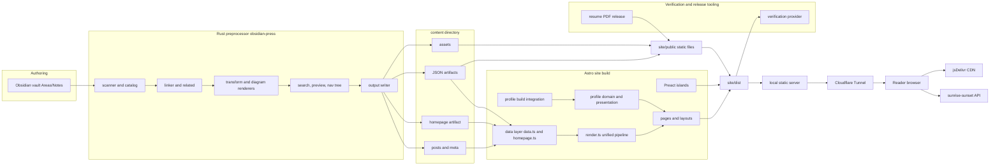
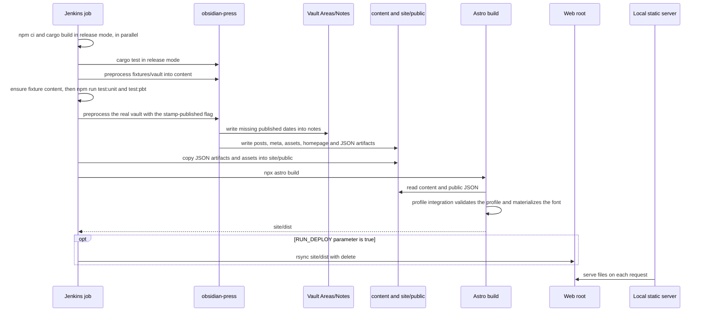
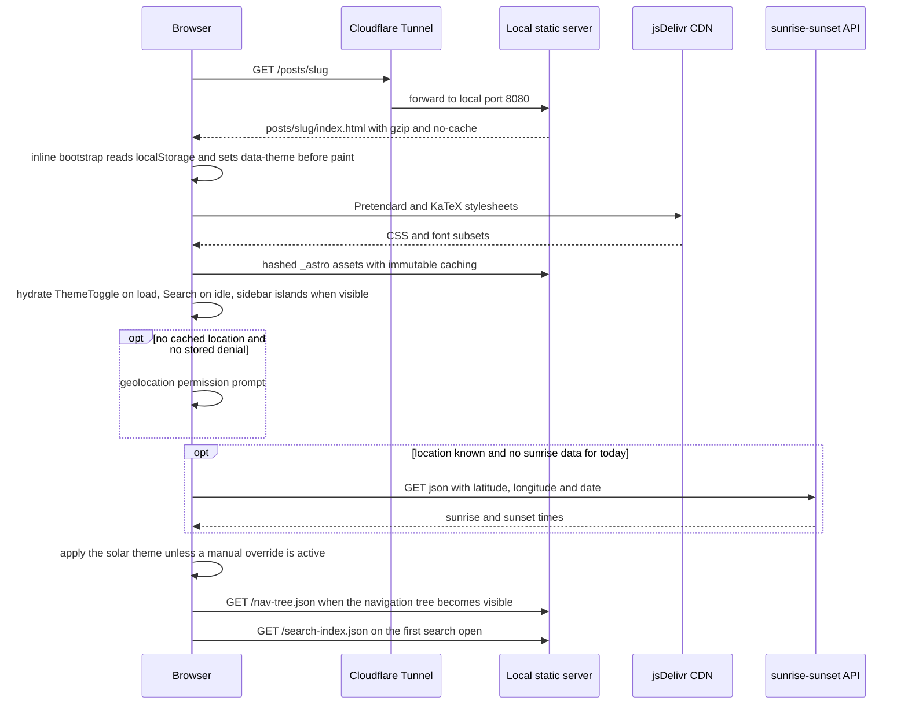
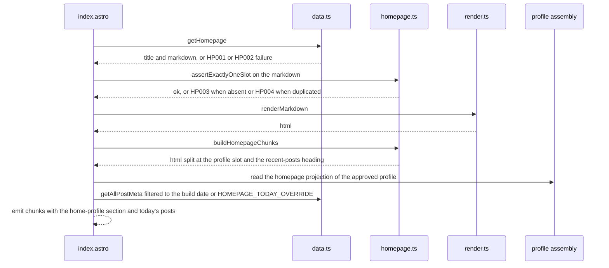
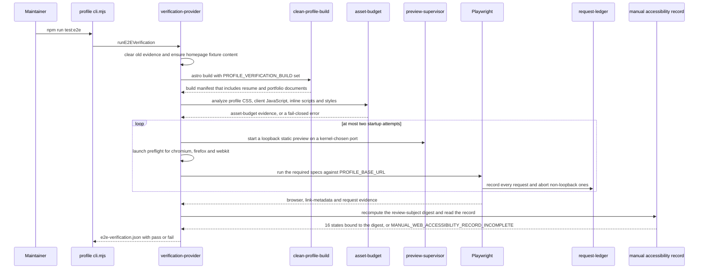
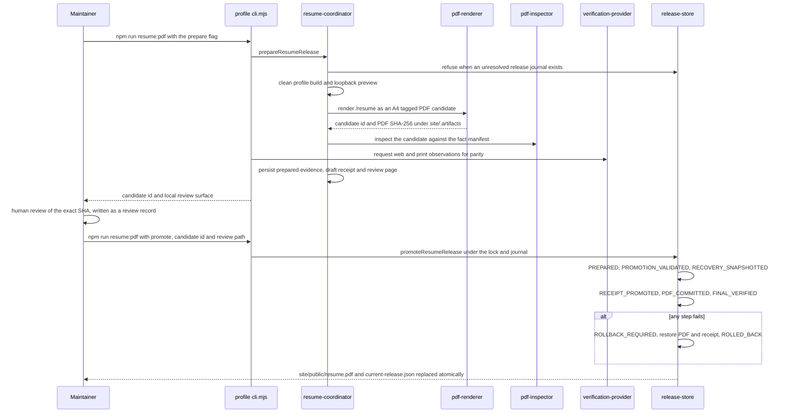

# Architecture: obsidian-blog (obsidian-press)

## Architecture Analysis

### System Overview

obsidian-press is a build-time publishing system with no application server. A Rust command-line preprocessor turns the Obsidian vault into a normalized `content/` directory: markdown fragments with embedded HTML, per-post metadata JSON, assets, and global JSON artifacts. An Astro 6 static build then renders every route to HTML. Preact islands handle the few interactive features: theme toggle, search, navigation tree, graphs and the mobile sidebar.

A dependency-free Node server serves the built files from a local web root behind a Cloudflare Tunnel.

The professional-profile subsystem is a separate concern inside the same Astro site. It has a strongly typed fact domain, its own stylesheets and font, and a large Node tooling layer that verifies the rendered pages (accessibility, resources, budgets) and releases the PDF résumé through a journaled transaction.

Sizes measured by line count:
- preprocessor/src: about 3,500 lines of Rust
- blog presentation code (pages, layouts, components, islands, client scripts, stylesheets): about 5,000 lines
- site/src/lib/profile: about 16,500 lines of TypeScript
- site/scripts/profile: about 20,900 lines of JavaScript

### Architectural Style

- **Pipes and filters (batch).** The preprocessor runs fixed passes: scan, catalog, link, transform, search, output. main.rs runs the scan, catalog checks and `write_output`, and output.rs drives linking, transformation, search, previews, related posts and the navigation tree. It fails the whole run on publication diagnostics or diagram render failures.
- **Static site generation with islands.** `output: 'static'` (site/astro.config.mjs). All HTML is prerendered, and client JavaScript is limited to opt-in islands (`client:load`, `client:idle`, `client:visible`) and a handful of hoisted or inline scripts.
- **Functional core with fail-closed boundaries** in the profile domain. Pure normalization, validation, projection and digest modules feed Astro components. Results are `ValidationResult` values or thrown diagnostics; partial output is never produced.
- **Evidence-oriented tooling.** Verification and release commands produce JSON evidence bound to build identities and source digests. Human decisions are recorded as receipts.
- **Single-host deployment.** Static files are served by one Node process supervised by launchd. There is no CDN of its own; Cloudflare Tunnel provides ingress.

### Component Relationships

<!-- Text fallback: The vault feeds the Rust preprocessor, whose passes run in order (scanner and catalog, linker and related, transform and diagram renderers, search with preview and nav tree, output writer). The writer produces posts and meta, the homepage artifact, JSON artifacts and assets in content/. JSON artifacts and assets are copied to site/public. The Astro data layer reads content, render.ts renders markdown, and pages and layouts are built together with the profile domain, which the profile build integration validates. Pages, islands and site/public end up in site/dist. The verification provider reads site/dist. The resume PDF release writes into site/public. site/dist is served by the local static server through the Cloudflare Tunnel to the reader's browser, which also calls the jsDelivr CDN and the sunrise-sunset API. -->

### Data Flow

1. **Content.** The scanner reads markdown from the vault (`VAULT_PATH`, defaulting to fixtures/vault/ in `just` dev recipes). It parses frontmatter (`tags`, `created`, `published`, `is_hub`, `hub_parent`, `description`, `visibility`) and derives `updated` from one batched `git log`. The catalog enforces the publication boundary. The linker resolves wikilinks into backlinks and forward links. The transform pass converts Obsidian syntax to HTML fragments and renders diagrams to SVG under `content/assets/`. The search pass builds a Korean inverted index. The output writer emits `content/posts/<slug>.md`, `content/meta/<slug>.json`, `content/homepage/`, and `graph.json`, `search-index.json`, `previews.json`, `nav-tree.json` and `manifest.json`. Contracts are in api-documentation.md.
2. **Build.** `site/src/lib/data.ts` reads `../content` relative to the working directory. `getStaticPaths` in each page enumerates posts, hubs and tags. `renderMarkdown` (site/src/lib/render.ts) turns post markdown into HTML that layouts insert with `set:html`. Previews are read from `public/previews.json`.
3. **Profile.** Approved facts (site/src/lib/profile/profile-data.ts) are normalized, validated against the approval receipt, assembled once per build (`getProductionProfileAssembly`), projected per surface (résumé, portfolio, homepage, metadata, PDF) and converted to renderer-neutral view models (site/src/components/profile/presentation.ts) consumed by Astro components.
4. **Client runtime.** Theme state lives in `localStorage` (`theme`, `theme-manual`, `solar`, `geo`, `geo-denied`) and is applied as `data-theme` on `<html>`. Islands fetch `/nav-tree.json` and `/search-index.json` lazily. The post pages embed the local graph data in the island props, while the graph page passes `graph.json` data as props.
5. **PDF.** The release tooling renders `/resume` from a clean build to a private candidate under `site/.artifacts/profile/pdf/`. After human review it promotes the candidate to `site/public/resume.pdf` and writes `site/verification/resume/current-release.json`.

### Key Design Decisions

Each decision below was reconstructed from code and the repository's design records. Alternatives marked "inferred" are not documented in the repository.

**KD-1: Two-stage pipeline, a Rust preprocessor plus an Astro static site**
- Context: Obsidian syntax (wikilinks, transclusions, callouts, block references, diagrams) and a Korean search index must be produced from a personal vault on every publish (docs/plans/2026-03-15-obsidian-publish-replacement-design.md).
- Decision: a Rust CLI normalizes the vault into `content/`, and Astro renders the site.
- Alternatives considered: keep Obsidian Publish (the hosted service being replaced); do everything in Astro with remark/rehype plugins over the raw vault (inferred).
- Consequences: fast deterministic batch processing and strong typing for link resolution. The cost is two toolchains and an implicit raw-HTML contract between the stages: `rehype-raw` is mandatory, and CSS depends on preprocessor class names.
- Security: there is no runtime server code. Vault HTML is trusted and rendered through `set:html` (site/src/layouts/PostLayout.astro, site/src/pages/index.astro), so stored XSS is possible if the vault ever accepts third-party content. The build executes external CLIs (`mmdc` through puppeteer and Chrome, `d2`, `typst`) on vault content.

**KD-2: Custom unified render pipeline instead of Astro's markdown configuration**
- Decision: site/src/lib/render.ts owns the remark and rehype chain: GFM without single tilde, CJK-friendly emphasis, definition lists, abbreviations, math, raw HTML, Shiki dual themes with `defaultColor: false`, slugged headings, code filenames, figure captions, table wrappers and KaTeX with `strict: false`.
- Alternatives considered: plugins declared in astro.config.mjs markdown settings; MDX (inferred).
- Consequences: one place defines the article HTML structure (figures, code blocks, tables), and a redesign of article typography touches render.ts as well as CSS. CLAUDE.md warns that astro.config.mjs markdown settings are not the rendering path.
- Security: raw HTML passes through unsanitized (no `rehype-sanitize`).

**KD-3: Attribute-driven theming with sunrise and sunset auto-switching**
- Decision: tokens are defined on `:root` and redefined under `[data-theme="dark"]` (site/src/styles/global.css:2-32). An inline ES5 bootstrap sets the attribute before first paint (site/src/layouts/BaseLayout.astro:112-169). ThemeToggle requests geolocation, fetches sunrise and sunset times, and switches at each boundary (site/src/islands/ThemeToggle.tsx:53-107, site/src/lib/solar.ts). A manual toggle overrides until the next boundary or for at most 24 hours. The design is recorded in docs/superpowers/specs/2026-04-10-theme-transition-design.md.
- Alternatives considered: CSS `prefers-color-scheme` media blocks (present earlier, removed as redundant in docs/project/codebase_audit.md); a manual-only toggle (inferred); following the OS setting live through `matchMedia` change events (inferred, not implemented).
- Consequences: no flash of the wrong theme and smooth 300 ms crossfades. The OS appearance is used only before any theme has been saved; after that it is ignored, and OS changes are never observed. Theme logic is duplicated in the ES5 bootstrap and solar.ts. Two ThemeToggle instances (desktop and mobile header) each run the geolocation and timer logic.
- Security and privacy: a geolocation permission prompt appears on page load without a user gesture or explanation. Coordinates go to api.sunrise-sunset.org. Location is cached in `localStorage` for 30 days.

**KD-4: Split font strategy**
- Decision: blog and legacy routes load Pretendard Variable (dynamic subset) and KaTeX CSS from jsDelivr. Profile routes load no external resources and use a locally materialized, hash-verified alias `RVNNT Profile` built from the `pretendard` 1.3.9 package (site/src/lib/layout/profile-resources.ts, site/scripts/profile/font-materializer.mjs).
- Alternatives considered: self-host one font for all routes (inferred); rely on the system stack (`-apple-system`, `BlinkMacSystemFont`), which is already the fallback in `--font-body`.
- Consequences: profile pages render deterministically for print and PDF, and their verification requires a local `.woff2` request. Blog pages depend on CDN availability. `--font-code` names JetBrains Mono, which is never loaded, so code falls back to `ui-monospace` and SFMono.
- Security: the CDN stylesheets have no Subresource Integrity attributes, so the blog trusts jsDelivr. The local font is pinned by package integrity (sha512) and per-file sha256.

**KD-5: Code-defined, receipt-gated profile domain**
- Decision: profile facts are TypeScript data validated against a human approval receipt with canonical digests. Branded types and WeakSet capabilities stop unvalidated data from reaching components.
- Alternatives considered: author the profile as vault notes; a plain JSON or CMS content file without approval gating (inferred).
- Consequences: strong truthfulness and traceability guarantees, but heavy machinery: every copy change needs a new receipt revision. Role editions reuse facts by ID (site/src/lib/profile/portfolio-roles.ts).
- Security: approval metadata stays out of the public graph, and the build fails if receipt identities appear in output (`assertNoProfileApprovalLeak`).

**KD-6: Static-first interaction**
- Decision: profile disclosures and the mobile navigation use native `
` rendered without hydration (site/src/islands/MobileNav.tsx is used without a client directive). Profile routes ship no new client JavaScript (asset budget).
- Alternatives considered: a Preact island with a hamburger icon (the original plan in docs/plans/2026-03-17-responsive-design.md); script-driven accordions (inferred).
- Consequences: navigation and disclosures work with JavaScript disabled (tested in site/tests/e2e/profile-cross-browser.spec.ts and crossunit.spec.ts). Motion and state styling are limited to what `details` supports.
- Security: a smaller client attack surface.

**KD-7: Self-hosting on one Mac behind Cloudflare Tunnel**
- Decision: launchd runs site/scripts/local-server.mjs on port 8080 and Cloudflare Tunnel publishes it. S3, CloudFront, ACM and Terraform were removed on 2026-08-17 (CLAUDE.md).
- Alternatives considered: the previous AWS S3 and CloudFront stack (docs/project/codebase_audit.md); a managed static host (inferred).
- Consequences: no hosting cost and a simple deploy (`rsync`). Availability depends on one machine, and port ownership conflicts with Jenkins have happened (CLAUDE.md, 2026-08-29).
- Security: the CloudFront response-headers policy (CSP, HSTS, X-Frame-Options, Referrer-Policy) went away with AWS. local-server.mjs sends only `X-Content-Type-Options: nosniff`. Whatever Cloudflare adds at the edge is configured outside the repository. CLAUDE.md says launchd sets `HOST=0.0.0.0`, which exposes the server to the LAN.

**KD-8: Evidence-bound, fail-closed verification with human gates**
- Decision: `npm run test:e2e` combines a clean build, an asset budget, a loopback request ledger, a 48-key browser matrix and a human accessibility record bound to a review-subject digest into one verdict (site/scripts/profile/verification-provider.mjs).
- Alternatives considered: conventional pass/fail suites in CI; screenshot-based visual regression (inferred).
- Consequences: very strong guarantees for profile pages. A benign edit to any review-subject file invalidates the human review. The tracked record (12 states) no longer satisfies the 16-state contract, and CI does not run this command, so the gate is currently red without anyone being notified (inferred from code).
- Security: the ledger aborts any non-loopback request during verification, and process supervision prevents orphaned browsers and servers.

### Improvement Opportunities

- Make appearance follow the operating system by default, as HIG expects. Keep a manual override, and make sunrise and sunset switching opt-in so the page-load geolocation prompt goes away. This removes the duplicated bootstrap logic as well.
- Introduce a single semantic token layer shared by the blog and profile styles. Today the profile adds `--c-profile-*` overrides, callouts use hardcoded palettes, and graph colors are hardcoded in site/src/lib/graphUtils.ts. Remove the unused dark-only callout tokens.
- Decide one font strategy. Either self-host the body font for all routes (removing the CDN dependency and adding integrity) or adopt the system stack for blog routes while keeping the verified local font where the profile gates require it.
- Separate the redesign from the human review gate. Re-scope `REVIEW_SUBJECT_SOURCE_FILES` or plan a fresh 16-state review as part of the redesign. Run `test:e2e` in CI or at least before deploy.
- Add browser and visual coverage for blog routes, which currently have none (see code-quality-assessment.md).
- Restore security headers at the server or tunnel (CSP compatible with the inline bootstrap hashes, HSTS, Referrer-Policy, frame-ancestors). Add SRI to remaining CDN resources.

## Interaction Diagrams

### Daily publish (Jenkins)

<!-- Text fallback: Every night Jenkins installs npm packages and builds the preprocessor in parallel, runs cargo tests, preprocesses the fixture vault into content, ensures fixture content and runs the unit and property tests. It then preprocesses the real vault with the stamp-published flag, which writes missing published dates back into vault notes and writes posts, meta, assets, the homepage and JSON artifacts. The JSON artifacts and assets are copied into site/public and Astro builds site/dist, during which the profile integration validates the profile and materializes the font. Only when RUN_DEPLOY is true does Jenkins rsync site/dist into the web root, from which the local static server serves requests. -->

### Reader opens a post

<!-- Text fallback: The browser requests a post through the Cloudflare Tunnel, which forwards to the local server on port 8080. The server returns gzip-compressed HTML marked no-cache. Before first paint an inline script reads localStorage and sets the data-theme attribute. The browser loads Pretendard and KaTeX stylesheets from jsDelivr and hashed Astro assets from the server with immutable caching. ThemeToggle hydrates on load, Search when idle and the sidebar islands when visible. If no location is cached and none was denied, the browser shows a geolocation prompt. If a location is known but today's sunrise data is missing, it calls the sunrise-sunset API. The solar theme is applied unless a manual override is active. The navigation tree JSON is fetched when that island becomes visible, and the search index on the first search open. -->

### Homepage composition at build time

<!-- Text fallback: index.astro asks data.ts for the homepage artifact, which fails with HP001 or HP002 when it is missing or invalid. homepage.ts asserts exactly one profile slot line (HP003 when absent, HP004 when duplicated). render.ts renders the markdown to HTML, and homepage.ts splits it at the profile slot and at the legacy recent-posts heading. The page reads the homepage projection of the approved profile and the posts published on the build date (or the HOMEPAGE_TODAY_OVERRIDE date), then emits the chunks with the home-profile section and the today's-posts list in place of the slot and the heading. -->

### Profile verification (npm run test:e2e)

<!-- Text fallback: The maintainer runs npm run test:e2e, which calls the verification provider. It clears old evidence, ensures homepage fixture content, and runs a clean Astro build with PROFILE_VERIFICATION_BUILD set, producing a build manifest. The asset budget analyzes profile CSS, client JavaScript and inline scripts and styles, failing closed on any violation. Up to two startup attempts each start a loopback preview, run a browser launch preflight for chromium, firefox and webkit, and run the required Playwright specs while the request ledger records every request and aborts non-loopback ones. The provider then recomputes the review-subject digest and reads the manual accessibility record, which must contain 16 states bound to that digest; otherwise it fails with MANUAL_WEB_ACCESSIBILITY_RECORD_INCOMPLETE. The verdict is written to e2e-verification.json. -->

### Resume PDF release

<!-- Text fallback: The maintainer runs resume:pdf with the prepare flag. The coordinator refuses if an unresolved release journal exists, runs a clean profile build and loopback preview, renders /resume to an A4 tagged PDF candidate under site/.artifacts, inspects it against the fact manifest while the CLI obtains web and print observations from the verification provider for parity, and persists the prepared evidence, a draft receipt and a local review page. The maintainer reviews the exact SHA and writes a review record, then runs resume:pdf with promote, the candidate id and the review path. The release store walks the journal states PREPARED, PROMOTION_VALIDATED, RECOVERY_SNAPSHOTTED, RECEIPT_PROMOTED, PDF_COMMITTED and FINAL_VERIFIED. If any step fails it moves to ROLLBACK_REQUIRED, restores the PDF and receipt and ends ROLLED_BACK. On success site/public/resume.pdf and current-release.json are replaced atomically. -->
