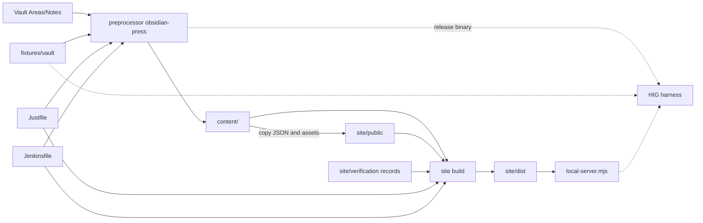

# Dependencies

## Internal Cross-package Dependencies

Text fallback: the preprocessor reads the real vault (or `fixtures/vault`) and writes `content/`. The site build reads `content/` directly and also needs the four JSON files and assets copied into `site/public/`, plus the tracked approval records in `site/verification/`. The build output in `site/dist/` is served by `local-server.mjs`. The HIG harness depends on the release preprocessor binary, the fixture vault and the local server. The Justfile and the Jenkinsfile drive both packages.

### Contract details that couple the packages

| Coupling | Producer | Consumer | Breaks when |
|---|---|---|---|
| `content/` location | Justfile/Jenkins pass `./content` from the repo root | `data.ts` `path.resolve('../content')`, `render.ts` `../content/assets`, `homepage-fixture-content.mjs` | the site is built from a cwd other than `site/`, or the output path changes. |
| JSON shapes | `output.rs`, `types.rs`, `search.rs`, `nav_tree.rs`, `preview.rs` | `site/src/lib/types.ts` (hand-mirrored), `search.ts` validator, `graphUtils.parseGraphData` | a field is renamed or added on one side only. |
| URL scheme `/posts/<slug>`, `/` for the homepage | `transform.rs` `convert_wikilinks`, `hub_dates.rs` regex | pages, `link-preview.ts` selector `a[href^="/posts/"]`, LocalGraph/GraphView hrefs | posts move to another prefix. |
| Slug rules | `scanner.rs` `slugify_heading` (matches rehype-slug) | heading fragments, TOC, `rehype-slug` IDs | either side changes its slug algorithm. |
| Homepage artifact + profile slot | `output.rs` `write_homepage` | `getHomepage` (HP001/HP002), `homepage.ts` (HP003/HP004), fixture materializer, Jenkins Verify | the homepage note is removed or the slot token changes. |
| Copied JSON in `site/public/` | Justfile, Jenkinsfile, `hig/build-and-serve.mjs` | islands at run time; `getPreviewSummary` at build time | the copy step is skipped (build still succeeds with empty summaries). |
| Review-subject files | `accessibility-review-contract.mjs` | `test:e2e` (manual record digest) | any listed file changes. |

### Module-level dependencies inside the preprocessor

- `main` → `scanner`, `catalog`, `output`, `transform`
- `catalog` → `syntax`, `transform`, `types`
- `output` → `catalog`, `linker`, `nav_tree`, `preview`, `related`, `search`, `transform`, `types`
- `transform` → `syntax`, `types`, `scanner` (`slugify_heading`), `hub_dates`, `d2`, `mermaid`, `typst_render`
- `hub_dates` → `transform` (`transform_outside_fences`), `types` (mutual reference with `transform`, no cycle in data)
- `linker`, `nav_tree`, `related`, `preview`, `search` → `types` (+ `syntax`, `transform::strip_frontmatter`)
- `scanner` → `syntax`, `types`

### Module-level dependencies inside the site

- Pages → `lib/data.ts`, `lib/render.ts`, layouts, components; profile pages → `lib/profile/production-profile.ts`, `lib/profile/metadata.ts`, `components/profile/presentation.ts`.
- `layouts/BaseLayout.astro` → `components/Header.astro`, `islands/Search.tsx`, `lib/layout/*`, `lib/site.ts`, `.generated/profile-font/*` (materialized at config setup).
- `components/Header.astro` → `lib/navigation.ts` → `lib/profile/issues.ts`, `lib/profile/types.ts` (the navigation model shares the profile validation vocabulary).
- `lib/render.ts` → `lib/home-sections.ts`, `lib/image-size.ts`, Shiki theme JSON.
- `pages/index.astro` → `lib/homepage.ts`, `lib/profile/production-profile.ts`.
- `lib/layout/profile-resources.ts` → `lib/profile/portfolio-roles.ts`.
- `astro.config.mjs` → `scripts/profile/astro-profile-integration.mjs` → `lib/profile/production-profile.ts`, `scripts/profile/font-materializer.mjs`.
- No circular imports were observed in the files read.

## External Dependencies

### Rust crates (direct)

anyhow, clap, serde, serde_json, serde_yml, walkdir, regex, chrono, tempfile, lindera (embed-ko-dic); dev: proptest. Risk notes: `serde_yml` is pre-1.0 (0.0.12); lindera embeds the Korean dictionary, which makes release builds heavy but offline.

### npm packages

- Runtime (28 declared): Astro 7 and integrations, Preact, unified/remark/rehype stack, Shiki, KaTeX, d3 modules, lucide, pretendard.
- Dev (19 declared): TypeScript, Vite (pinned 8.3.5), Vitest, fast-check, Playwright (pinned), axe (pinned), pdfjs-dist (pinned), Prettier (pinned), type packages.
- Override: `sharp ^0.35.5`.
- `package.json` and `package-lock.json` are accessibility review subjects: any dependency change invalidates the manual review record.

### System tools and services

| Dependency | Needed for | Failure mode |
|---|---|---|
| `d2`, `mmdc` + Chrome, `typst` | diagram rendering | run exits 1 after writing output, naming each failed diagram. |
| `git` | `updated` dates | silently `null` (git errors are swallowed). |
| `rsync` | deploy | Jenkins stage fails. |
| Node (launchd plist path) | serving | site down until the plist is updated after a Node upgrade. |
| Cloudflare Tunnel | public access | rvnnt.dev unreachable; LAN access still works. |
| Jenkins on 127.0.0.1:8081 | nightly publish | no publish; never start it with `brew services` (it would take port 8080). |
| iCloud vault path | real content | Preprocess stage fails. |

## Dependencies Relevant to the Active Intent

### 이전 인텐트(personal-website)의 기록 — 보존

- B1 site pages: Vault Scanner, Publication Catalog, Output Writer, Discovery Index Builders, `data.ts`, Justfile `publish_vault`, Jenkins `VAULT_PATH`, `stamp_published_dates`, `find_attachment`.
- B2 Writing section: `data.ts` (`getAllPostMeta`, `getTagIndex`, `getPreviewSummary`), `PostCard.astro`, new pages under `site/src/pages/writing/`.
- B3 site-built homepage: `catalog.rs` (PUB002 cardinality), `output.rs` `write_homepage`, `data.ts` `getHomepage`, `homepage.ts`, `index.astro`, fixture materializers, Jenkins Verify, U2 tests.
- B4 Tags/Graph move and redirects: `pages/tags/*`, `pages/graph.astro`, `navigation.ts` (review subject), PostLayout/HubLayout tag links, `local-server.mjs` (no redirects), link sweep, HIG/crossunit/homepage specs and the navigation PBT arbitraries.
- Later rounds: `lib/profile/*` and `scripts/profile/*` (facts source, approval receipt, résumé release).

### 현재 인텐트(post-deploy-runner) — 금번 스캔에서 확인

| 의존 대상 | 왜 필요한가 | 미검증/리스크 |
|---|---|---|
| `site/scripts/publish-dist.sh` | 두 배포 경로가 공유하는 유일한 게시 진입점(`Jenkinsfile:116`, `Justfile:29`). 러너의 삽입점. | 없음(44줄 심독). |
| 리다이렉트 테이블 `_redirects.json` | H3의 301이 이 테이블에서 나온다고 가정. 테이블은 `rsync`에서 제외되고 마지막에 원자적 교체됨(`publish-dist.sh:34-44`). | 테이블을 소비하는 서버 구현(`local-server.mjs`, `redirect-table.mjs`)은 스냅샷 범위 밖이라 미검증. |
| `site/scripts/sync-public-assets.mjs` | 두 배포 경로와 HIG 하네스가 모두 호출(`Jenkinsfile:97`, `Justfile:20,41`, `hig/build-and-serve.mjs:60`). | 폴더 목록으로 존재만 확인. |
| `rollback-runbook.md` (이전 인텐트 레코드) | 실패 시 T1/T2 트리거 연결 대상. | 파일 목록으로 위치만 확인, 내용 미독 — 트리거 정의는 요구사항 단계에서 재확인. |
| `site/package.json` | 명령 추가 시 review subject 충돌. | 새 명령은 `Justfile`/`site/scripts/`에 둘 것. |
| 웹 루트 `~/Sites/obsidian-blog` + 정적 서버 :8080 | H1/H2/H3 요청 대상. | 서버 재읽기 타이밍(테이블 교체 직후)으로 인한 일시 실패 가능성. |
