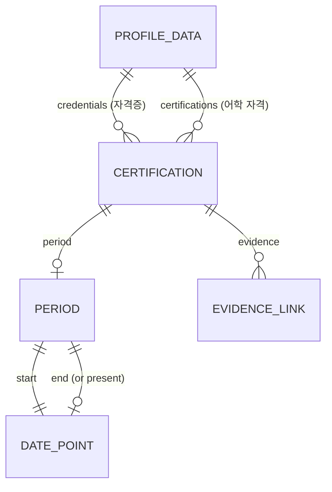

# Functional Specification: Résumé Certifications

This is the source of truth for the workflows below. Data shapes live in `entities.md` and decision logic lives in `rules.md`. This file carries two derived views.

## Workflow 1: Build the résumé from approved facts

1. **Load.** The build loads `profile-data.ts`, which holds both `credentials` (AWS) and `certifications` (OPIc IH).
2. **Normalize and validate.** Every period passes BR1.1–BR1.3, and the full-date points pass BR2.1. Ids are unique across both collections (BR4.1).
3. **Approve.** The fact approval chain recomputes the inventory, approved-record, materialized and production-diff digests. It matches them against the r9 receipt and stops on any mismatch (BR6.1).
4. **Present.** Presentation builds the sections in the order intro, skills, highlights, projects, 학력, 자격증, 어학 자격, and leaves out any empty one (BR4.2). Every period text follows BR3.1.
5. **Manifest.** The résumé manifest records seven section keys: `intro-contact`, `skills`, `highlights`, `project-summaries`, `education`, `credentials`, `certifications`. A new manifest numbers them 1–7 (BR6.2).
6. **Render.** The page renders each section with its own `data-profile-section` marker (`credentials`, `certifications`) and the shared entry layout (BR4.3).

## Workflow 2: Fact revision r9

1. **Write r9.** Write `docs/resume/product-engineer/inventory-r9.json` from r8:
   - remove the two `certification-hsk-6-*` facts;
   - revise `certification-opic-ih-period`;
   - add `certification-opic-ih-issuer` and the five AWS facts (title, issuer, period, evidence label, evidence destination).
2. **Add evidence.** Add evidence E16, a user confirmation recorded on 2026-10-21. Point the changed facts at E16 in the evidence membership map.
3. **Pin the digests.** Compute the canonical digests once and pin them in `production-profile.ts` (`EXPECTED_RECEIPT`, the materialized digest and the fact count). Write the matching receipt to `site/verification/profile/fact-approval.json`.
4. **Record the revision.** Write `revision-r9.md` beside r9. It records the request, the confirmation and the digests, as `revision-r7.md` does.

## Workflow 3: PDF candidate and publication order

1. **Prepare.** After the suites pass, run `npm run resume:pdf -- --prepare` once. The candidate must pass web/print/PDF parity, which includes the dotted period text (BR3.2). It may run one page longer (BR6.3).
2. **Promote, then push.** The maintainer reviews the candidate and runs `--promote`.
3. **Publication order (recommended).** Promote before pushing `develop`. The nightly deploy publishes the web résumé from `develop`, while the PDF only changes on promotion. Pushing first would leave the published PDF at r8, still listing HSK, until the promotion. This is a recommendation for the maintainer; the build does not enforce it.

## Derived view: entity relationships

Text fallback: ProfileData has two lists of Certification: credentials (자격증) and certifications (어학 자격). A Certification has an optional Period, whose two ends are DatePoints (the end may be "present"), and zero or more EvidenceLinks.

## Derived view: rules summary

The source is `rules.md`.
- **Validation:** BR1.1 (real day), BR1.2 (one precision), BR1.3 (no reversal), BR5.2 (the link).
- **Constraints:**
  - BR2.1: every layer accepts full dates.
  - BR3.2: web, print and PDF parity.
  - BR4.1: one section per certification.
  - BR6.2: the r8 record stays readable.
- **Display and policy:**
  - BR3.1: dotted dates.
  - BR4.2: section order.
  - BR4.3: shared entry layout.
  - BR5.1: the confirmed facts.
  - BR6.3: PDF candidate.
- **Authorization:** BR6.1, the r9 receipt.

## Edge cases

- **Future expiry dates.** An expiry after today, such as 2027-09-06 or 2029-07-17, is valid. It is not a reversed range (BR1.3).
- **Mixed precision.** A period with a full-date start and a year-month end is rejected (BR1.2).
- **Impossible days.** `2026-02-29` (2026 is not a leap year) and `2025-09-31` are rejected (BR1.1).
- **Empty collections.** A profile with no credentials renders no 자격증 heading (BR4.2). The property tests generate such profiles.
- **One section per certification.** The same certification placed in both collections is rejected (BR4.1). That also keeps the PDF's render-once rule intact.
- **Shared formatter.** The portfolio pages use the same period formatter, so their periods turn dotted as well (assumption in `requirements.md`).
