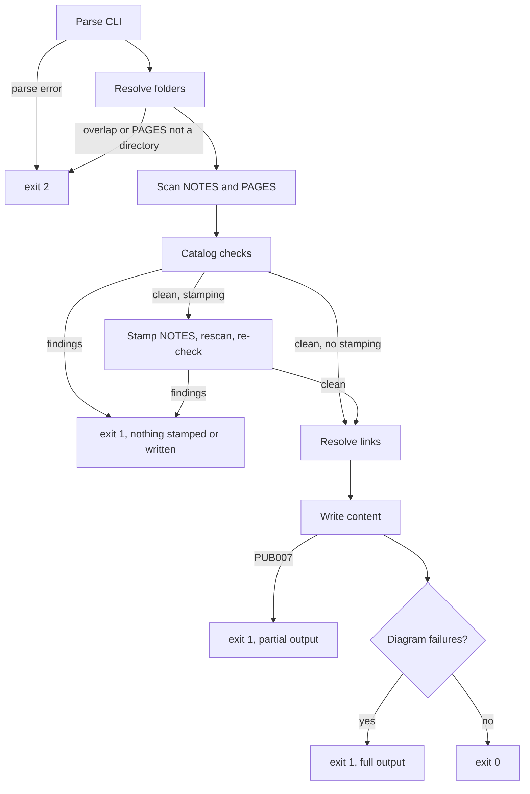
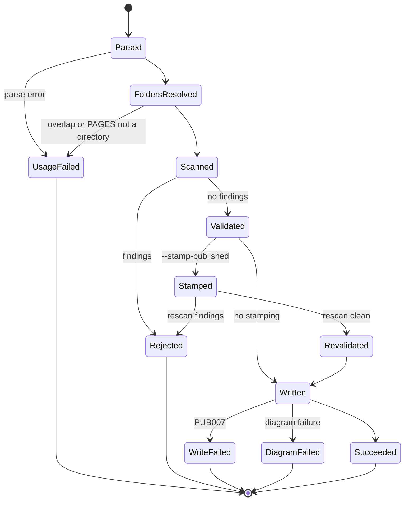
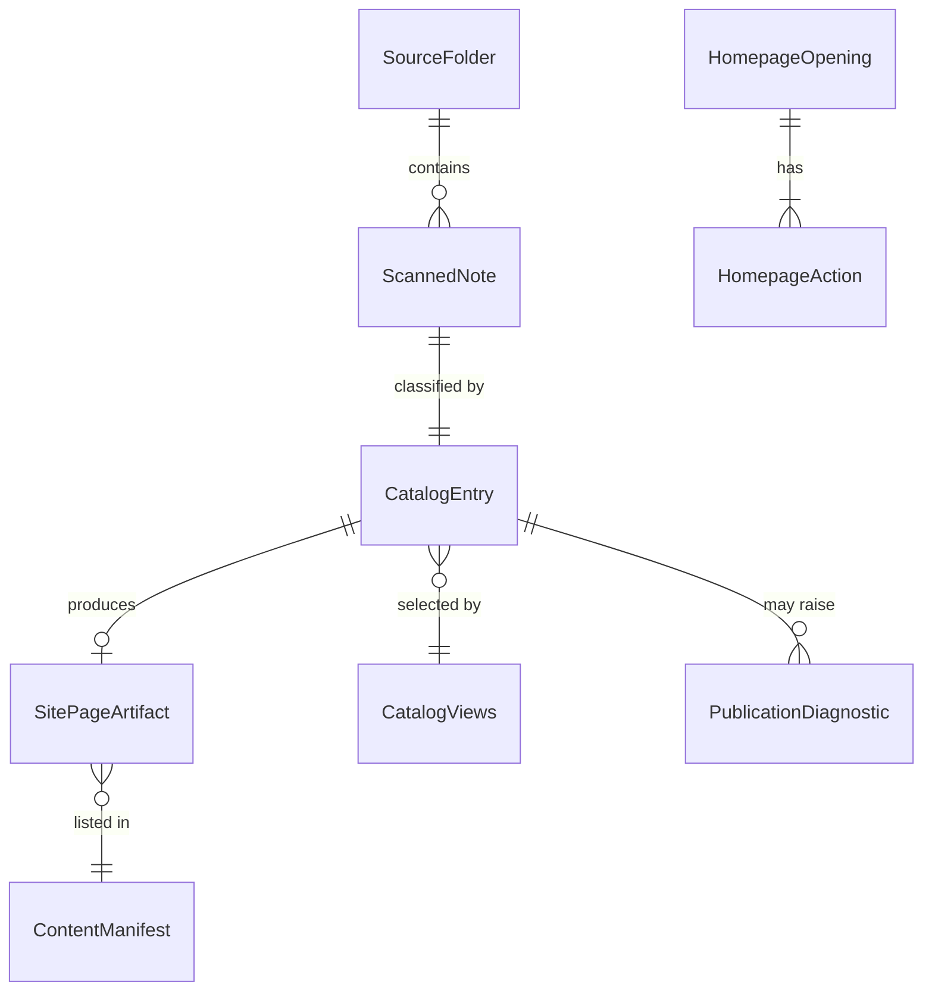

# Functional Specification — U1 `u1-publish-boundary`

Upstream: `inception/units-generation/unit-of-work.md` (U1), `unit-of-work-story-map.md`; `inception/user-stories/stories.md` — this unit implements **US1.1, US1.2, US1.3, US2.1, US2.2, US3.1, US3.2** and its share of **US7.1**; `inception/requirements-analysis/requirements.md`; `inception/domain-design/components.md`, `decisions.md`; `inception/contract-design/contract-summary.md` (C1, C2); answers in `functional-design-questions.md` (Q1–Q9).

This file is the source of truth for workflows and state transitions. Data shapes live in `entities.md`, decisions in `rules.md`; the ER diagram and rules summary below are derived views.

## 1. Scope

In: publishing step (CLI, scanner, catalog, links, stamping, writer), the site's homepage opening and data layer, the pipeline wiring and the fixture vault.
Out: the weekly list, `/writing` pages (U2); tags/graph moves and redirects (U3); navigation (U4); routes for site pages (later release).

## 2. Workflows

### W1 — Publishing run

1. **Parse** `obsidian-press <NOTES> <OUTPUT> [--pages <PAGES>] [--stamp-published]`. A parse error exits 2 (unchanged).
2. **Resolve folders.** Canonicalise NOTES and, when given, PAGES. Apply BR1.2 (overlap → exit 2) and BR1.3 (notice, or exit 2 for a non-directory). Nothing has been read yet.
3. **Scan** NOTES, then PAGES if present, with the skip rules (BR1.4). Tag each note with its source (BR1.5) and sort (BR1.7).
4. **Catalog.** Classify (BR2.1–BR2.2), then check BR2.3–BR2.6. Report every finding sorted and exit 1 if any (BR2.7). Nothing has been stamped or written.
5. **Stamp** (only with `--stamp-published`): stamp NOTES (BR4.2), then rescan both folders and rebuild the catalog (repeat steps 3–4). A finding at this point exits 1 before writing (BR4.1).
6. **Resolve links** from the posts-only view: backlinks and graph (BR3.4).
7. **Write** (BR5.1): clean managed namespaces; write posts and meta, then site pages (BR5.2, BR5.3), then global indexes from the posts-only view (BR5.4), then the manifest (BR5.5). A write error is PUB007 (BR5.7).
8. **Diagram check.** A diagram failure in any post or site page exits 1 after output (BR5.7, unchanged).
9. **Exit 0.**

Text fallback: parse, resolve folders (overlap or bad pages path → exit 2), scan both folders, run every catalog check (findings → exit 1 with no stamping or writing), stamp and re-check when asked, resolve links, write, then exit 1 on diagram failures or 0 otherwise.

### W2 — Classification (decision table)

| Source | visibility | Kind | Notes |
|---|---|---|---|
| pages | any or none | site_page | visibility not checked (BR2.1) |
| notes | none or `post` | post | hubs are posts (`is_hub`) as today |
| notes | `homepage` | retired_homepage | at most one (BR2.3) |
| notes | anything else | — | PUB001 |

Then, over the classified set:

| Situation | Result |
|---|---|
| site page slug = post slug | PUB008 (page path, post path) |
| site page slug = site page slug | PUB008 (both page paths; the earlier path in sort order is `path`) |
| site page slug = retired note slug | PUB008 (page path, retired note path) |
| post slug = post slug | warning, as today |
| post or site page embeds the retired note | PUB004 / PUB005 / PUB006 |
| post or site page embeds a site page | PUB009 |
| retired note embeds anything | not checked (it is not published) |

### W3 — Link rendering (in post and site-page bodies)

| Target | Rendered as | Backlink / graph edge |
|---|---|---|
| post | anchor `/posts/<slug>[#fragment]` | yes, if the source is a post |
| retired homepage note | anchor `/`, no fragment | no |
| site page | plain text (alias or target name) | no |
| unknown | plain text, as today | no |

### W4 — Site-page write

For each site_page entry in slug order: transform the body with the post pipeline (W3 links; embeds of posts allowed; diagrams and math as for posts), copy images found under PAGES (BR1.6) to `assets/`, write `pages/<slug>.md` and `pages/<slug>.json` `{slug, title}`, and add all three kinds of file to the manifest.

### W5 — Homepage build (site)

1. `index.astro` no longer reads `content/homepage/`; it uses only post metadata and the Profile Domain (BR6.1).
2. Render the h1 "Passion Project" (`SITE_NAME`), then owner name and short introduction from the homepage profile selection, without the headline (BR6.2, BR6.3).
3. Render two plain capsules, "Résumé" → `/resume`, "Portfolio" → `/portfolio` (BR6.4).
4. Render the interim "오늘 발행된 글" list from post metadata using the existing build-date rule (BR6.5). U2 replaces this section.

### W6 — Nightly pipeline and verification

- **Verify:** `cargo test --release` → `obsidian-press fixtures/vault/Notes ./content --pages fixtures/vault/Pages` → copy JSON → fixture content (no homepage files) → `npm run test:unit`, `npm run test:pbt`.
- **Preprocess:** `obsidian-press "$VAULT_PATH" ./content --pages "$PAGES_PATH" --stamp-published`; a missing `Areas/Pages` shows the notice in the console and the run continues.
- **Local:** `just preprocess` (fixtures pair), `just deploy` (`publish_vault` + `publish_pages`), HIG `build-and-serve.mjs` (fixtures pair).

## 3. Run lifecycle (state machine)

Text fallback: Parsed → FoldersResolved → Scanned → Validated → (Stamped → Revalidated) → Written → Succeeded. UsageFailed exits 2. Rejected exits 1 and the vault and content are untouched. WriteFailed and DiagramFailed exit 1 as today.

| State | Vault changed? | `content/` changed? | Exit |
|---|---|---|---|
| UsageFailed | no | no | 2 |
| Rejected | no | no | 1 |
| WriteFailed | only dates stamped in this run | partially | 1 |
| DiagramFailed | only dates stamped in this run | fully written | 1 |
| Succeeded | only dates stamped in this run | fully written | 0 |

## 4. Edge cases

| Case | Behaviour | Rule |
|---|---|---|
| `--pages` omitted | zero pages, `pages_not_given` notice | BR1.3 |
| `Areas/Pages` missing | zero pages, `pages_missing` notice | BR1.3 |
| `Areas/Pages` empty, or only `Drafts/` and dot-files | zero pages, no notice | BR1.3, BR1.4 |
| `--pages` is a file | exit 2 | BR1.3 |
| `--pages` = NOTES, or inside it, or containing it | exit 2 | BR1.2 |
| No retired homepage note | success | BR2.3 |
| Site page marked `visibility: homepage` or with a bad value | site page, no error | BR2.1 |
| Site page links to a post | anchor to the post; no backlink on the post | BR3.1, BR3.4 |
| Post links to a site page | plain text | BR3.3 |
| Site page embeds a post | allowed, rendered as for posts | BR5.2 |
| Site page image only in `Areas/Notes/attachment/` | not found (bounded), warning | BR1.6 |
| Korean file names | slug by the existing rule; any truncation by character, never by byte | team rule |
| Stale `content/homepage/` from an older run | removed by the clean | BR5.1 |

## 5. Test plan anchors (test-first)

| Behaviour | Where | Fixture |
|---|---|---|
| Fixture move | every Rust test path `../fixtures/vault` → `../fixtures/vault/Notes`; Justfile, Jenkins, HIG script | `fixtures/vault/Notes`, `Pages` |
| BR1.2, BR1.3 | CLI integration tests (exit code, stderr) | temp dirs |
| BR1.1, BR1.6 | sentinel file and image beside NOTES are never read or copied | temp vault |
| BR2.1–BR2.7 | `publication_catalog.rs` examples and properties (folder-first, PUB008 variants, PUB009 variants, no PUB002) | temp vaults + fixture |
| BR3.x | `publication_transform.rs` (retired → `/` no fragment; page → text; no edges) | fixture |
| BR4.1, BR4.2 | stamping with a PUB008 vault leaves files byte-identical; pages never stamped | temp vault |
| BR5.x | `publication_output.rs` (pages files, manifest, no homepage, determinism property) | fixture |
| BR6.1–BR6.6 | Vitest for data layer; Playwright HIG + axe for `/` (4 widths, light/dark, reduced motion, no other origin, JS off) | built fixture site |
| BR7.2 | removed homepage tests (HP001–HP004, slot); e2e homepage specs updated | — |

## 6. Entity-relationship view (derived from `entities.md`)

Text fallback: a source folder contains scanned notes; each note has one catalog entry; a site-page entry produces one artifact listed in the manifest; entries are selected into the two views and may raise diagnostics; the homepage opening has two actions.

## 7. Rules summary (derived from `rules.md`)

- **Inputs (BR1.1–BR1.7):** read only NOTES and PAGES; no overlap (exit 2); missing pages folder → notice; skip rules everywhere; source recorded; bounded image lookup; fixed order.
- **Catalog (BR2.1–BR2.8):** folder first; visibility for posts only; homepage optional, at most one; PUB008 for any site-page clash; PUB004–006 for retired-note embeds; PUB009 for site-page embeds; batch and fail closed; two views.
- **Links (BR3.1–BR3.4):** posts unchanged; retired note → `/`; site page → text; only post-to-post counts.
- **Stamping (BR4.1–BR4.2):** check first, then stamp NOTES only.
- **Output (BR5.1–BR5.7):** `pages/` added, `homepage/` gone; page images copied; post indexes only; sorted manifest; deterministic; write failures unchanged.
- **Site (BR6.1–BR6.6):** no artifact reader; one h1; name + intro; two capsules; interim today list; a11y bar.
- **Pipeline (BR7.1–BR7.3):** `--pages` everywhere; no homepage fixture; fixture vault mirrors production.

## 8. Contract notes

- C1 is unchanged: its fixture caller line already reads `fixtures/vault/Notes` / `fixtures/vault/Pages` (Q1 B). Additive: exit 2 for overlapping folders or a non-directory `--pages`; new PUB009; the `pages_not_given` notice text.
- C2 is unchanged in shape; `CLAUDE.md` records the removed `homepage/` namespace and PUB002/HP001–HP004 removal, per the contract ownership rule.
- Merge precondition: the owner rewords the project rule on `Areas/Notes` to name `Areas/Pages` (C1 open question; follow-up F4).
