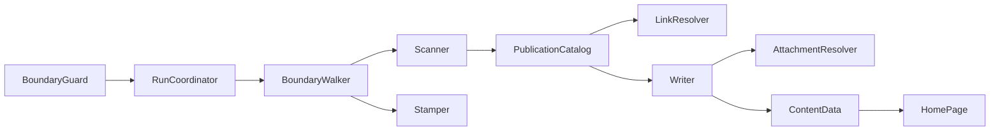

# Logical Components — U1 `u1-publish-boundary`

Upstream: `inception/domain-design/components.md`; `functional-design/functional-spec.md`; `nfr-requirements/*`; the NFR designs in this folder.

Component names extend the domain catalogue. **New** marks a logical component this design adds inside an existing domain component, not a new deployable.

| Logical component | Domain component | NFR patterns applied | Failure domain | Blast radius if wrong |
|---|---|---|---|---|
| BoundaryGuard (new) | PreprocessorCli | path resolution, overlap check (NOTES, PAGES, OUTPUT), exit 2 | before any I/O | wrong wiring stops the run; nothing touched |
| RunCoordinator | PreprocessorCli | fail-closed ordering, skip second scan when nothing stamped, pages notices | whole run | ordering bug could stamp before a failure: covered by vault-hash tests |
| BoundaryWalker (new, shared) | VaultScanner, DateStamper | single walk policy, link skip with warning, skip rules | per folder | a policy bug affects scan and stamp alike: tested once, used twice |
| Scanner | VaultScanner | source tag, deterministic sort | per note | malformed note warns (as today) |
| Stamper | DateStamper | NOTES only, walker-fed, reports change count | vault NOTES | writes only `published`; never PAGES; never through links |
| PublicationCatalog | PublicationCatalog | folder-first, PUB001/003–006/008/009, batch and sort | whole run | a missed check could publish wrongly: property test against a reference |
| AttachmentResolver (new) | OutputWriter | bounded lookup, link and real-path rejection, `assets/pages/` | per image | missing image → warning only |
| LinkResolver | LinkResolver | post-only graph; retired note → `/`; page → text | per link | wrong link text; no data leak |
| Writer | OutputWriter | managed clean incl. legacy `homepage/`, `pages/`, sorted manifest, summary counts | OUTPUT only | partial output on PUB007 (unchanged); Deploy never runs |
| ContentData | ContentData (site) | no artifact reader; ordinary posts and hubs separately | site build | build fails loudly on missing content |
| HomePage | HomePage (site) | static, same-origin, no island | `/` | page-level; Playwright and axe gate |
| NightlyPipeline | NightlyPipeline | `--pages` everywhere; Verify on the fixture pair; no homepage materialisation | Jenkins job | red build; live site keeps the previous build |

## Shared resources

| Resource | Shared by | Isolation |
|---|---|---|
| Vault NOTES | Scanner (read), Stamper (write) | stamp only after a clean catalog; walker-fed |
| Vault PAGES | Scanner (read) | never written |
| `content/` | Writer (write), site build (read), HIG fixture builds (write) | BoundaryGuard forbids overlap with the vault; the fixture builds write fixtures (restore with `just preprocess`) |
| `assets/` | post and page images | page images under `assets/pages/` |

## Flow

Text fallback: the guard runs first; the coordinator drives the walker, which feeds both the scanner and the stamper; the catalog feeds link resolution and the writer; the writer uses the attachment resolver and produces content the site's data layer reads for the homepage.
