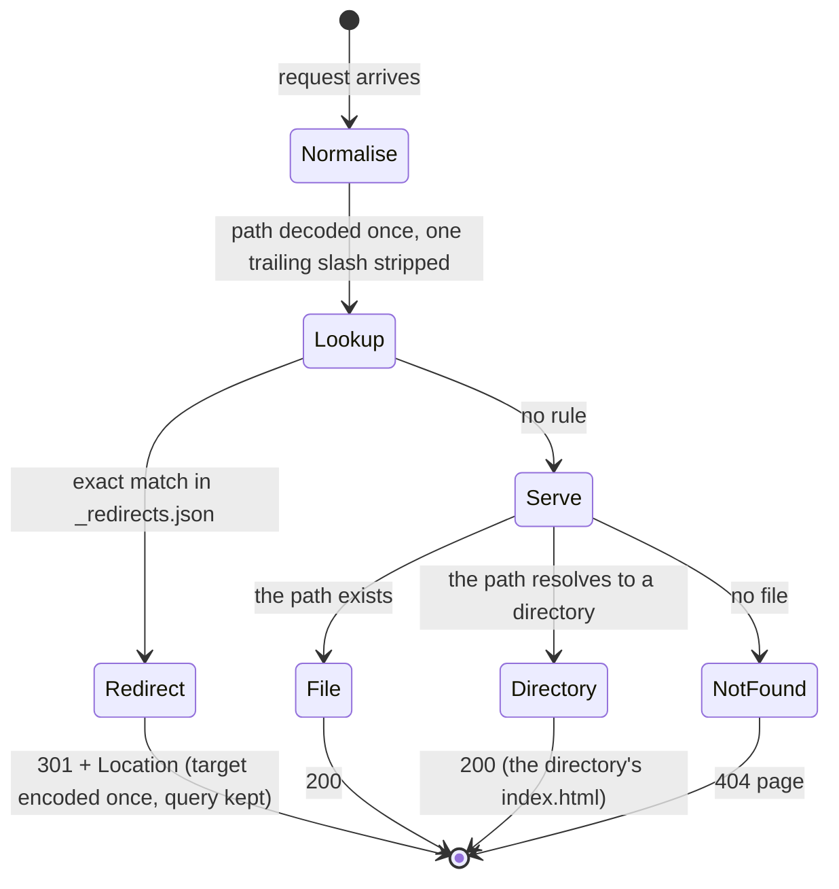

# Functional Specification — U3 `u3-writing-moves`

Upstream: `inception/units-generation/unit-of-work.md` (U3), `unit-of-work-story-map.md`; `inception/user-stories/stories.md` — this unit implements **US5.1, US5.2** and its share of **US4.1** and **US7.1**; `inception/requirements-analysis/requirements.md` (FR5.1–FR5.4, NFR1–NFR4, NFR6); `inception/refined-mockups/` (M4, interaction spec "Old-Address Redirect (server)", accessibility checklist); `inception/domain-design/components.md` (DiscoveryPages, LegacyRedirects, StaticServer, WritingPages); `inception/contract-design/contract-summary.md` (C3, C4, C5).

Rules are in `rules.md`. Components are in `frontend-components.md`.

## 1. Scope

| In | Out |
|---|---|
| the tag index, tag pages and graph page served under `/writing/...` | the Writing landing page itself (U2) |
| one shared address module for every internal tag and graph link | the primary navigation bar and sheet (U4) |
| the build-time redirect table `_redirects.json` | the preprocessor and the publish boundary (U1) |
| the server's redirect lookup and 301 answer | the deployment pipeline and the Jenkins job (no change needed) |
| the server's clean-URL rewrite, extended so a path that resolves to a directory is served by that directory's `index.html` | the preprocessor, the publish boundary and the tag key rule (the sanitized key keeps dots, and a dotted key's page directory is served by the extended rewrite) |
| updating the tests that assert the old addresses | the manual 16-state accessibility review rerun (owner, release end) |

## 2. Inputs

| Input | Source | Notes |
|---|---|---|
| Sanitized tag index with its posts | `site/src/lib/data.ts` `getTagIndex()` | the same keys as today; the move changes addresses only (BR1.3) |
| Tag key derivation | the shared address module (BR2.1) | `/` and whitespace runs become `-`, the name is lower-cased; one implementation for the pages and the table |
| Graph data | the graph page's existing data module and `public/graph.json` | unchanged content; the data file stays at `/graph.json` (BR2.4) |
| Post and hub tag chips | `PostLayout.astro`, `HubLayout.astro` | call the shared address module (BR2.1) |
| Writing capsules | `site/src/pages/writing/index.astro` | call the shared address module (BR2.3) |
| Built tag pages | the build output's `writing/tags/<key>/` directories | the tag keys the table's per-tag rules are derived from (BR3.1) |
| Request path and query | the static server | decoded once; the query is kept for a redirect (BR3.2, BR3.3) |
| Redirect table | `_redirects.json` at the site root | written by the build (BR3.1); re-read when it appears or changes (BR3.5) |

## 3. Workflows

### W1 — Serve the tag index under `/writing/tags` (BR1.1, BR1.2, BR1.3)

1. The tag index page is built at `/writing/tags`; the build produces no page at `/tags`.
2. The page keeps today's content: the chip per tag with the tag name and its post count, the empty state when there are no tags.
3. Above the Large Title the page shows one plain "‹ Writing" back link to `/writing`.
4. Each chip links to the tag's new page address, built by the shared address module (BR2.1, BR2.2).

### W2 — Serve one page per tag under `/writing/tags/<tag>` (BR1.1, BR1.2, BR1.3)

1. One page is built per current tag, at `/writing/tags/<sanitized tag>`; the build produces no page at `/tags/<tag>`.
2. The page keeps today's content: the Large Title with the tag name, the post list with previews, the empty state when the tag has no post.
3. Above the Large Title the page shows the same "‹ Writing" back link.
4. The page's own links to posts and to the tag index use the existing address rules; only tag addresses come from the shared address module.

### W3 — Serve the graph under `/writing/graph` (BR1.1, BR1.2, BR1.3)

1. The graph page is built at `/writing/graph`; the build produces no page at `/graph`.
2. The page keeps today's content and structure: its `graph-header` with the Large Title and the two tabs, the graph panel with the island, and the list panel with the same graph as a list of links.
3. Above the Large Title the page shows the same "‹ Writing" back link.
4. The graph island still fetches `/graph.json`; that file is data, not a page, and is not an old address (BR2.4).

### W4 — Build every internal tag link through one address module (BR2.1, BR2.2, BR2.3)

1. The module owns the addresses of one tag key: the tag index `/writing/tags`, a tag page `/writing/tags/<key>`, the graph `/writing/graph`, and the old forms `/tags`, `/tags/<key>` and `/graph`.
2. The module returns the decoded address and the encoded address (each segment percent-encoded exactly once). The encoded form is what goes into markup and into a Location header; the decoded form is what the redirect table stores (BR3.1).
3. The tag index page, the post tag chips, the hub tag chips, the Writing capsules and the redirect-table writer call the module; no call site writes a tag or graph address as a literal.
4. The Writing capsules keep their labels, icons and layout and point at the new addresses.

### W5 — Write the redirect table into the build output (BR3.1)

1. The site build writes `_redirects.json` at the site root, that is `site/dist/_redirects.json` in the build output, which the nightly rsync copies to the web root unchanged.
2. The writer is a build step of the site itself: an Astro integration's build-done hook, registered in the site's Astro config. Both `just site-build` and the Jenkins Build Site step keep running the same `npx astro build` command, so no pipeline stage is added and no npm lifecycle hook is relied on.
3. The writer takes the tag keys from the tag pages the build produced — the `writing/tags/<key>/` directories in the output — so the rules and the pages cannot drift apart. Each key is read once and decoded once.
4. The file has the shape `{ "version": 1, "rules": [ { from, to } ] }`, where `from` and `to` are decoded absolute paths without a trailing slash, exactly as contract C4 states.
5. The rules are the two fixed rules (`/tags` → `/writing/tags`, `/graph` → `/writing/graph`) plus one `/tags/<key>` → `/writing/tags/<key>` rule per built tag page. The rules are unique and sorted by `from`, so two builds of the same vault produce the same bytes.

### W6 — Answer an old address with a permanent redirect (BR3.2, BR3.3)

1. Before looking for files, the server reads the request path, decodes it once and strips one trailing slash (except for `/`).
2. The server looks the result up in the table's `from` values; the match is exact, never a prefix match.
3. On a match the server answers 301 with a `Location` header holding the rule's decoded target, each segment percent-encoded exactly once, followed by the original query string when the request carried one.
4. `/tags` and `/tags/` answer 301 with `Location: /writing/tags`; `/graph` and `/graph/` answer 301 with `Location: /writing/graph`; `/tags/<tag>` answers 301 with the matching `/writing/tags/<tag>`.

### W7 — Serve everything else normally (BR3.2, BR3.4, BR3.5, BR3.6)

1. A path with no rule is served as today: a file when it exists, otherwise the 404 page. `/graph.json` is served as a file.
2. A path that resolves to a directory inside the web root is served by that directory's `index.html`, whatever the path's shape — so a tag key containing a dot (`/writing/tags/node.js`) is served like every other tag page (BR3.6).
3. A tag that is not in the table has no rule and is answered with the normal 404.
4. If the table is absent, unreadable, not valid JSON, of an unknown version or not shaped as a rule list — or if a rule's `from` or `to` is not a decoded absolute path without a trailing slash — the server serves files normally, answers no redirect and writes one error line to its log; it never fails a request and never redirects to an address it cannot prove.
5. The server re-reads the table when its presence or its modification time changes, so a table that appears after the server started is picked up without a restart.
6. The one manual restart is pinned: the new server code is restarted after U3 merges and before the first nightly deploy that ships the moved pages. Between that restart and the deploy the old pages are still in the web root and no table exists, so the server serves them normally and answers no redirect, and no old address breaks; the deploy then brings the new pages and the table together and the running server picks the table up. This is the answer to the open question on C4 in the contract summary.

## 4. Screen states

| Path | Page | Content | Chrome marker | Back link |
|---|---|---|---|---|
| `/writing/tags` | tag index | chips with counts, empty state | `aria-current="true"` once U4 lands | "‹ Writing" → `/writing` |
| `/writing/tags/<tag>` | tag page | Large Title, post list, empty state | `aria-current="true"` once U4 lands | "‹ Writing" → `/writing` |
| `/writing/graph` | graph page | graph header with the two tabs, graph panel, list panel | `aria-current="true"` once U4 lands | "‹ Writing" → `/writing` |
| `/tags`, `/tags/` | none (build) | — | — | — |
| `/tags/<tag>` | none (build) | — | — | — |
| `/graph`, `/graph/` | none (build) | — | — | — |
| `/graph.json` | data file | the graph data, unchanged | — | — |

The marker column describes U4's rule only; U3 creates the routes and U4 marks them. The marker rule does not wait for U3 (BR1.4 in U4's rules).

## 5. Request states

Text fallback: a request is normalised (decode once, strip one trailing slash), then looked up exactly in the redirect table. A match answers 301 with the encoded target and the original query. No match is served as a file, served as the `index.html` of the directory the path resolves to, or answered with the 404 page. A missing or invalid table means every request takes the no-match path.

## 6. Edge cases

| Case | Behaviour | Rule |
|---|---|---|
| `/tags` and `/tags/` | 301 → `/writing/tags` | BR3.2, BR3.3 |
| `/graph` and `/graph/` | 301 → `/writing/graph` | BR3.2, BR3.3 |
| `/tags/운영체제` | 301 → `/writing/tags/%EC%9A%B4%EC%98%81%EC%B2%B4%EC%A0%9C` | BR2.2, BR3.3 |
| `/tags/<tag>?from=post` | 301, query kept: `Location: /writing/tags/<tag>?from=post` | BR3.3 |
| `/graph.json` | served as a file, never redirected | BR3.2 |
| `/tags/nonexistent` | no rule → the normal 404 | BR3.2 |
| `/writing/tags/node.js` — a tag key containing a dot | the path resolves to a directory and is served by that directory's `index.html`, so the page the build produced is reachable at its address | BR3.6 |
| `/tagsold`, `/graph-old` | no rule → the normal 404; the match is exact | BR3.2 |
| `/tags/../graph` | the URL parser resolves the dot segment before the server sees the path, so the request is read as `/graph` and answers 301 → `/writing/graph` | BR3.2 |
| `//tags` | read as a protocol-relative URL, so the path is `/` and the homepage is served; no redirect | BR3.2 |
| invalid percent escape (`/tags/%zz`) | the server's existing decode fails and the request is answered 400 | BR3.2 |
| control character in the path | the decoded path cannot exist on disk, so the normal 404 is served | BR3.2 |
| table missing, unreadable, invalid JSON, unknown version, wrong shape, a rule whose path is not a decoded absolute path | no redirect, files served normally, one error line in the log | BR3.4 |
| table appears while the server runs | picked up on the next request, without a restart | BR3.5 |
| tag added or removed between builds | the rules are derived from the built tag pages, so a removed tag's rule is gone and its old address answers 404 | BR3.1 |
| tag whose sanitized key contains `/` or whitespace | the key is sanitized (`-`), used as one segment and encoded once | BR2.2 |
| JavaScript disabled | all three pages show their content and links; the graph's list panel stays visible | BR4.3 |
| a link written outside the address module | the link sweep finds it and the build fails the check | BR2.1, BR2.4 |

## 7. Contracts and integration

| Point | Owner | U3 use |
|---|---|---|
| C3 `/writing` route | U2 | the back link's target and the Writing landing page |
| C3 shared content files | U2 | the capsules' labels; unchanged |
| C4 `LegacyRedirects` → `StaticServer` | U3 | the `_redirects.json` table, its shape, its location and the lookup contract |
| C5 HTTP routes for visitors | U3 | the 301 answers and the query-keeping behaviour |
| C4 open question — the restart order | U3 | resolved in W7 step 6: the restart happens before the first nightly deploy that ships the moved pages |
| `site/src/styles/writing.css` — U2's stylesheet, shared with the `/writing` pages | U2 | the `.back-link` and `.back-link-chevron` rules move out of it into `grouped.css`, the stylesheet the three moved pages already load (BR1.2); a stylesheet-only cross-unit edit U3 owns and declares |
| `/writing/all` — U2's page | U2 | the page switches to the shared `BackLink` component (markup-only, no behaviour change); a cross-unit edit U3 owns and declares, landed after U2 because this workflow builds the units serially |
| U4 marker rule | U4 | the three moved pages inherit `aria-current="true"`; U3 waits for U4 and does not change the chrome |
| Preprocessor and vault | U1 | U3 reads only the built site data; it never touches the vault |

The server's redirect lookup happens before the file lookup, so the old addresses never fall through to the 404 page. The table is produced by the site build's own build-done hook, so `just site-build` and the Jenkins Build Site step need no change; the deploy copies `dist/` to the web root, and the table arrives with it.

## 8. Test anchors (test-first)

| Behaviour | Test |
|---|---|
| BR1.1, BR1.3 | Vitest `tests/unit/` (new): the build output contains `/writing/tags`, `/writing/tags/<tag>`, `/writing/graph` and no page at `/tags`, `/tags/<tag>` or `/graph`; the tag list matches `getTagIndex()` |
| BR1.2 | Playwright HIG: the three pages show the "‹ Writing" back link, one h1 and the same content as before |
| BR2.1, BR2.2 | Vitest (new): the address module returns the decoded and the encoded address of one key, old and new; every rendered link to a tag address comes from the module |
| BR2.3 | Playwright HIG `hig-writing.spec.ts`: the Tags capsule points at `/writing/tags` and the Graph capsule at `/writing/graph` (updated, not deleted) |
| BR2.4 | `just crossunit` link sweep over the built site; no `/tags` or `/graph` link |
| BR3.1 | Vitest (new): the build output holds `_redirects.json` with the shape, the decoded paths, the sorted unique rules, one rule per built tag page, and byte-identical output for two builds of the same data |
| BR3.2, BR3.3 | Two evidence levels. Module-level Vitest `tests/unit/redirect-table.test.ts`, importing the server's redirect module `site/scripts/redirect-table.mjs`, covers the pure functions and the table validation (the decoded-path match, the once-encoded target, the kept query, the invalid-table rejection). The 301 status, the `Location` header value and the kept query are evidenced at HTTP level against the running server: the HIG harness `site/scripts/hig/build-and-serve.mjs` serves `site/dist` through the production static server on 127.0.0.1:4329, so a request there observes the real answer — `/tags`, `/tags/`, `/graph`, `/graph/`, `/tags/<tag>` and `/tags/<tag>/` answer 301, `/graph.json` is served as a file, an unknown tag is answered 404 |
| BR3.6 | Vitest (new, server): a path that resolves to a directory is served by that directory's `index.html` — including a directory whose name contains a dot — while a path that resolves to a file is still served as the file and an unknown path is still answered 404 |
| BR3.4 | The same test: a missing, invalid, unknown-version or wrong-shaped table answers no redirect and no request fails |
| BR3.5 | The same test: the table is re-read when it appears and when its modification time changes |
| BR4.1 | the axe matrix in the HIG suite via `HIG_ROUTES` (the routes move to the new addresses), light/dark, four widths, reduced motion |
| BR4.2 | the HIG origin check on the three moved routes |
| BR4.3 | `just crossunit`: the no-JavaScript smoke is extended to `/writing/tags`, `/writing/tags/<tag>` and `/writing/graph`, and asserts that the graph's list panel is visible without JavaScript; the link sweep reports no old address |
| BR4.4 | `cargo test --release`, `npm run test:unit`, `npm run test:pbt`, `npm run format:check`, `npx astro check`, the HIG Playwright suites |

The old-address expectations in `hig-pages.spec.ts`, `hig-writing.spec.ts`, `hig-search.spec.ts`, `hig-profile.spec.ts` and `hig-performance.spec.ts` — the last one in its Core Web Vitals and mobile-network route lists — are updated by this unit, not deleted.

## 9. Rules summary (derived from `rules.md`)

- **Addresses:** the tag index, the tag pages and the graph live under `/writing/...`; the build produces no page at the old addresses.
- **Content:** the moved pages keep today's content and layout and gain one plain "‹ Writing" back link above the Large Title; its rules live in the stylesheet the moved pages already load.
- **Links:** one shared address module owns every tag and graph address, old and new; the decoded form is stored, the encoded form is used once; the built site links to no old address.
- **Redirects:** the site build's own build-done hook writes a sorted, unique `_redirects.json` with decoded paths and one rule per built tag page; the server matches exactly after one decode and one trailing-slash strip and answers 301 with the encoded target and the original query; a missing or invalid table means no redirect and no failure; the table is re-read when it appears or changes, and the first restart is pinned before the first deploy.
- **Serving:** a path that resolves to a directory is served by that directory's `index.html`, whatever the path's shape, so every page the build produced is reachable at its address — including a tag key containing a dot.
- **Bar:** accessibility, no-other-origin, no-JavaScript and green-suite obligations hold.
