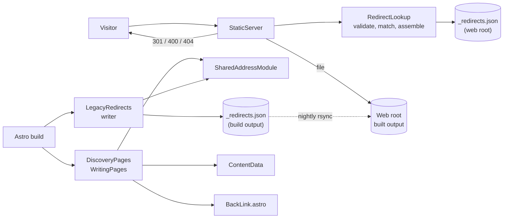

# Logical Components — U3 `u3-writing-moves`

Upstream (frozen): `construction/u3-writing-moves/nfr-requirements/performance-requirements.md`, `security-requirements.md`, `tech-stack-decisions.md`; `construction/u3-writing-moves/functional-design/functional-spec.md`, `rules.md`, `frontend-components.md`; `inception/contract-design/contract-summary.md` (C3, C4, C5); `inception/domain-design/components.md` (DiscoveryPages, LegacyRedirects, StaticServer, ContentData, WritingPages).

Unit kind: `ui`. This is the component-level view the Infrastructure Design stage consumes: where the NFR patterns above apply, which failure domain each piece sits in, and what the blast radius of each change is. U3 adds no infrastructure — the deploy, the web root and the launchd service are unchanged — so the inventory below is about logical boundaries inside the site, not about machines.

## 1. Component inventory

| Component | Kind | Owns | Depends on | Changed by U3 | Failure domain | Blast radius of a change here |
|---|---|---|---|---|---|---|
| **DiscoveryPages** | UI (Astro pages) | `/writing/tags`, `/writing/tags/<tag>`, `/writing/graph` — the three moved pages | ContentData (tag index, previews, graph data), the shared address module, `BackLink.astro` | yes — the pages move, gain one back link, and keep their data | build time (a page that fails to render fails the build) | every link to a tag or graph address, plus the tag index, the tag pages and the graph |
| **WritingPages** | UI (Astro pages) | `/writing` (the capsules) and `/writing/all` | ContentData, the shared address module, `BackLink.astro` | yes — the capsules are repointed, and `/writing/all` swaps its inline back link for the shared component | build time | the Writing landing page and the year list |
| **SharedAddressModule** (`site/src/lib/tag-urls.mjs`) | library | every tag and graph address, old and new, decoded and once-encoded | nothing | new (it replaces the literals the old pages used) | build time and request time (the writer and the pages call it) | every address in the site: one wrong derivation breaks links and rules at once — which is why BR2.1 makes it the single owner |
| **LegacyRedirects** (the Astro integration + the table writer) | build-time component | `_redirects.json` in the build output, and the check that every rule's target page exists in that output | the build's output directory, the built tag page directories | new | build time (a missing target page fails the build with `REDIRECT_TARGET_MISSING`; a malformed rule or duplicate `from` fails it too) | every old address; a missing table degrades to "no redirects", not to broken pages |
| **RedirectLookup** (`site/scripts/redirect-table.mjs`) | library | the table's validation, the exact match, the `Location` assembly — pure functions, no I/O beyond the table read the server asks it for | the web root (the table file) | new | request time (a bad table means no redirects; a thrown error would exit the process, which the design prevents) | every request; the design's guard is that the handler never throws and answers 400 or 404 instead |
| **StaticServer** (`site/scripts/local-server.mjs`) | runtime component | the HTTP surface: static files, the clean-URL rewrite, and **every response it writes** — the 301, the 400 and the 404 | RedirectLookup, the web root | yes — the lookup runs before the file lookup, a match's raw query is checked before assembly, and the clean-URL rewrite gains the directory-index branch (BR3.6); no file is read for a redirect target | request time | every request on the site; the change is deliberately small and additive |
| **ContentData** (`site/src/lib/data.ts`) | library | the sanitized tag index, the previews, the graph data | the preprocessed `content/` tree | no (BR1.3: the move changes addresses only) | build time | every page that reads content; U3 changes nothing here, so its risk is zero |
| **SiteChrome** (BaseLayout, Header, the shared islands) | UI | the header, the search island, the theme toggle, the global styles | ContentData | no | build time | every page; U3 touches nothing here, so the shared chrome stays as it is |

**One owner of the response.** `RedirectLookup` is a library of pure functions: it validates the table, finds the exact match and assembles the `Location` value. `StaticServer` is the only component that writes to the HTTP response — it calls `res.writeHead` for the 301, for the 400 and for the 404 — and it is also the only component that touches the file system for a request. The two never overlap: the lookup returns a value or nothing, and the server decides what to answer.

## 2. How the pieces fit

Text fallback: a visitor's request enters the static server, which asks the redirect lookup first. The lookup reads `_redirects.json` from the web root and returns the matched rule's target, or nothing; the server writes the response — the 301 when a rule matched and the request's query passes the raw-query check, the 400 when a matched request is refused, the 404 when there is no rule and no file — and otherwise serves a file from the web root, or a directory's `index.html`. The site build produces the pages and, in its build-done hook, the redirect table; both the pages and the writer take their addresses from the one shared address module, and the pages read their content from the content data. The nightly rsync copies the build output, including the table, into the web root.

## 3. Failure domains

| Failure | Where it is contained | What the visitor sees | What the design guarantees |
|---|---|---|---|
| The table file is missing, unreadable or malformed | the server's table acceptance (BR3.4) | the normal file behaviour; the old addresses are served as files if they still exist, or 404 | no redirect is answered that the server cannot prove; one error line; never a failed request |
| The table is written with a wrong shape | the writer's own test and the isolated-build check | — | the build's check fails before the table ships |
| A rule's target page is missing from the build output | the writer's target check (`security-design.md` §6, Rule 2) | a failed build; the nightly deploy does not run | no table naming a missing page is ever written; the rule is never silently dropped |
| A request carries a hostile query | the raw-query check and the header check (§4 of the security design) | 400 | the handler never throws, so the process stays up |
| A rule points outside the site | the table acceptance (an absolute path only, §5.1 of the security design) | no redirect | the `Location` value can only be the table's own target |
| A request's path resolves to a directory | the clean-URL rewrite's new directory-index branch | the directory's `index.html` | the containment check still applies to the resolved index |
| The publish copies the table before the pages it names | **not contained by U3's code**: handed to Infrastructure Design as a deploy-ordering requirement (§6.1 of the security design) | for a brand-new tag's old address only, a 301 followed by a 404 until its page lands | the residual is named, bounded to new tags in one publish, and closed by copying the table after the pages |
| The build's page step fails | the build | a failed build; the nightly deploy does not run | the table is written after the pages, so a failed build writes no table |
| The server process dies | launchd's restart | a short outage | unchanged from today; the unit adds no new reason to die (the handler never throws) |

## 4. Shared resources

| Resource | Shared by | How the unit keeps sharing safe |
|---|---|---|
| the web root | the whole site | the table is one file in it, read through the same containment check as every other file |
| `_redirects.json` | the build and the server | one shape (C4), one writer, one reader; the shape changes only with a new `version`, and the server ignores an unknown version |
| `grouped.css` | the tag pages, the graph page, `/writing/all`, the homepage | the back-link rules move into it; every page that loads it gets them, and the rules leave `writing.css` so there is one implementation |
| `writing.css` | the homepage, `/writing`, `/writing/all` | it loses the back-link rules and keeps the rest; no page loses a rule it had |
| the shared address module | the pages, the layouts, the writer | BR2.1 makes it the only place an address is written, so no call site can disagree with the table |
| the launchd service and the nightly rsync | the whole site | unchanged; the table rides the existing rsync, and the pinned restart (BR3.5) is the only operational step the unit adds |

## 5. What Infrastructure Design inherits

- **No new infrastructure.** No service, no process, no container, no volume, no port, no secret, no credential. The site keeps one Node process on one machine, launched by `dev.rvnnt.blog`, serving one directory.
- **One new file in the deployed artefact set**: `_redirects.json` at the web root, produced by the build and copied by the existing rsync (`rsync -a --delete`).
- **A deploy-ordering requirement.** The publish is not atomic: `rsync -a --delete` (`Justfile:30`, `Jenkinsfile:115`) can land `_redirects.json` before the `writing/` tree it names, and the server re-reads the table when its modification time changes, so new rules go live mid-copy. The server does not check targets at request time (NFR4.10, C4), so Infrastructure Design must make the table land **after** the pages — for example by copying the tree with the table excluded (an excluded destination file is neither replaced nor deleted, so the old table keeps serving the old rules) and then copying the table alone, in both `Justfile` and `Jenkinsfile` (`security-design.md` §6.1). The mechanism is Infrastructure Design's to choose.
- **The post-deploy check.** No automated post-deploy check exists today: the Jenkins Deploy stage is `mkdir -p` plus the rsync, and its `post` block only echoes (`Jenkinsfile:107-123`). The HTTP 200 check on `/` and one post is the maintainer's manual practice (team.md, Deployment), and an automated runner is still open follow-up F1 (`inception/practices-discovery/evidence.md:75`). The one-off U3 release check (`inception/delivery-planning/bolt-plan.md:45`) can request one legacy address — `/tags`, then the `Location` it was given — but it covers the U3 release, not every nightly publish. This design claims no per-deploy observation of the publish window; Infrastructure Design decides whether to schedule one.
- **One operational step**: restart `dev.rvnnt.blog` on the new server code after U3 merges and before the first nightly deploy that ships the moved pages (BR3.5, contract C4's open question). The table is picked up without a restart once it appears, because the server re-reads it when its presence or modification time changes.
- **Rollback**: reverting the U3 merge and rebuilding restores the old pages; the table disappears with the build output, and the server, still running the new code, then serves files normally because no valid table is present (BR3.4).

## 6. Isolation notes

- The redirect lookup is a separate module, not code inside the server script, so its behaviour can be tested without binding the blog's port (the server script listens at module scope).
- The writer is a separate build step, not a page route, so it cannot be reached at request time and cannot influence what the site serves — the table is inert data until the server reads it.
- The moved pages carry no new island and no new runtime dependency; the only client-side addition is an anchor.
