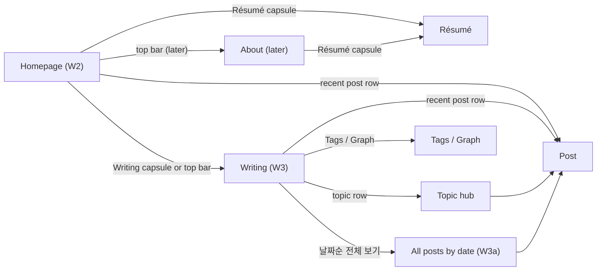

# User Flows — Passion Project personal website

Upstream: `ideation/intent-capture/intent-statement.md`; `ideation/scope-definition/scope-document.md`, `intent-backlog.md`. Screens refer to `wireframes.md` (W1–W4).

## Core Flow

Text fallback: from the homepage a visitor reaches Writing, a recent post or the résumé in one click. From Writing they reach a recent post, a topic hub, the full date list, or Tags and Graph in one click; hubs and the date list lead to posts. Later, About is in the top bar and links to the résumé.

## Flow 1 — Engineer browses the writing

Persona: engineer or reader (intent statement).
Trigger: arrives at the homepage from a link or search.

1. Homepage → reads the opening, scans "최근 글" → taps "모든 글 보기" or "Writing" in the top bar.
2. Writing → scans recent posts and topics → taps a topic.
3. Topic hub → taps a post → reads it.

Success: a post is open within 3 taps of the homepage.
Error paths:
- No posts in the last 7 days → the homepage shows the empty message with "모든 글 보기" → continues at step 2.
- Old bookmark to `/tags` or `/graph` → redirected to `/writing/tags` or `/writing/graph` (scope document B4).

## Flow 2 — Recruiter checks who the owner is

Persona: recruiter or hiring manager (intent statement).
Trigger: follows a link from a résumé or job application to the homepage.

1. Homepage → reads "Passion Project", the owner's name, headline and introduction.
2. Taps the "Résumé" capsule → reads the résumé (or downloads the PDF from there).
3. (Later) Taps "Projects" or "About" in the top bar → sees projects, contact links.

Success: the résumé is open in 1 tap from the homepage.
Error path: the résumé PDF is not published yet → the résumé page still shows the web résumé (existing behaviour).

## Flow 3 — Friend checks what the owner is doing now (later)

Persona: friend, classmate or community member (intent statement).
Trigger: arrives at the homepage.

1. Homepage → scrolls to the Now section (later, B10) or taps "Now" in the top bar.
2. Now → reads the note and its "last updated" date.

Success: current activity visible in at most 1 tap.

## Keyboard and Screen-Reader Path (every flow)

Tab order: skip link → top-bar title → sections → search → appearance → page content in reading order. Each page has one h1, and h2 per section, so heading navigation mirrors the flows above.
