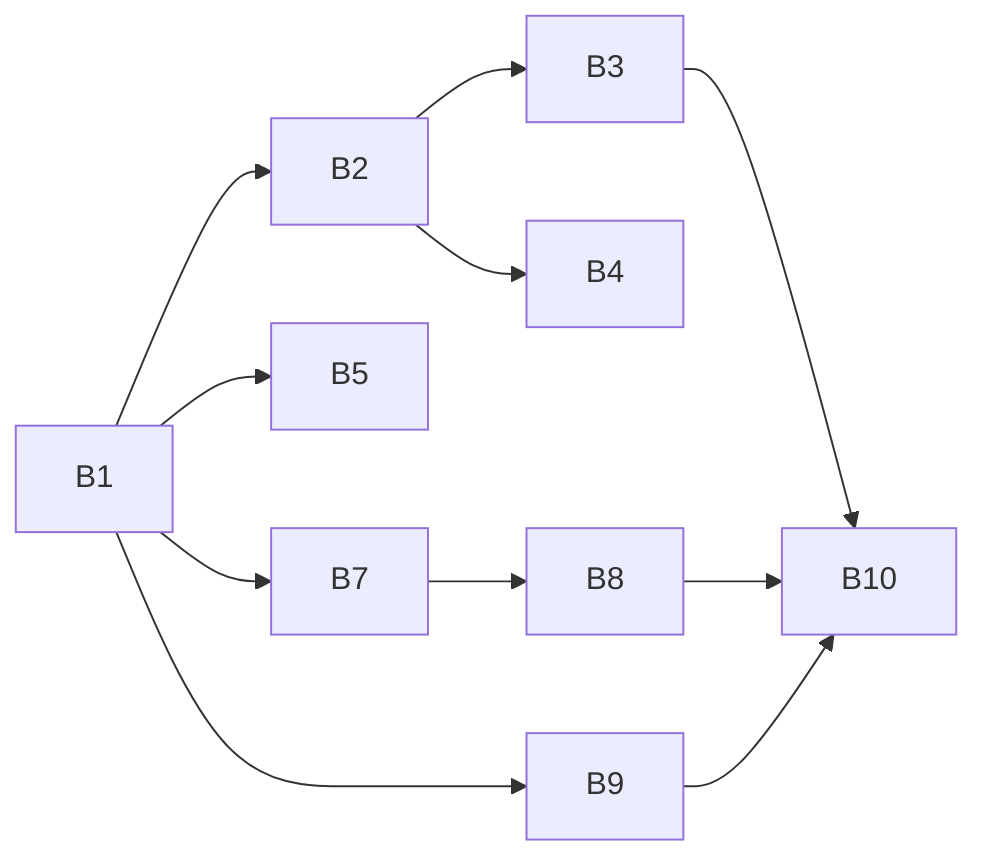

# Intent Backlog — Passion Project personal website

Upstream: `ideation/intent-capture/intent-statement.md`; `ideation/feasibility/feasibility-assessment.md`, `constraint-register.md`.

Prioritised with MoSCoW for this work, then ordered dependency first (Q3). "Must" items form the first release (Q1); "Should" items are in scope for later releases; "Could" marks the one item allowed to slip (Q2).

## Backlog

| ID | Proto-unit | MoSCoW | Depends on | Release | Source |
|----|-----------|--------|-----------|---------|--------|
| B1 | Site pages from the vault: a named folder outside `Areas/Notes`, published with `Areas/Notes`, its notes marked as site pages and kept out of the post lists | Must | — | Foundation | Q3, Q5 |
| B2 | Writing section: every published post, by date and by topic | Must | B1 (so site pages stay out of the list) | First | Q1; intent statement |
| B3 | Site-built homepage: who the owner is, latest writing; replaces the vault homepage note | Must | B1, B2 | First | Q1; intent statement |
| B4 | Tags and Graph under `/writing/...`, old addresses redirecting | Could | B2 | First, may slip | Q2; constraint C-T6 |
| B5 | About page from the vault | Should | B1 | Later | Q1; intent statement |
| B6 | Contact and links: `mailto:`, GitHub, LinkedIn, RSS | Should | — | Later | Q1; constraint C-T7 |
| B7 | Project facts from the vault for the portfolio, the résumé and the PDF résumé, keeping approval and identity checks | Should | B1 | Later | Q4; feasibility risk R1 |
| B8 | Projects showcase with detail pages | Should | B1, B7 | Later | Q1; intent statement |
| B9 | Now page from the vault | Should | B1 | Later | Q1; Market Research Q5 |
| B10 | Homepage additions: featured projects and current work | Should | B3, B8, B9 | Later | Intent statement |

## Dependency Order

Text fallback: B1 comes first. B2 follows B1, and B3 follows B2. B4 follows B2. B5, B7 and B9 each follow B1. B8 follows B7. B10 follows B3, B8 and B9. B6 depends on nothing.

## Value Stream

| Visitor | Outcome | Backlog items |
|---------|---------|---------------|
| Engineers and readers | Find and browse all writing | B1, B2, B4 |
| Recruiters and hiring managers | Understand the owner, see projects, reach the résumé and contact | B3, B5, B6, B7, B8, B10 |
| Friends and communities | See who the owner is and what they are doing now | B3, B5, B9, B10 |

## Every-Release Requirement

Each item ships with failing-first Playwright HIG and accessibility checks for its pages (constraint C-O3). The manual 16-state accessibility review is redone once, at the end (constraint C-O4).
