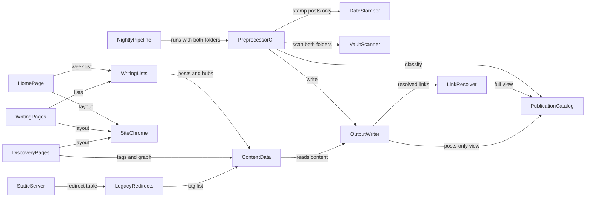

# Component Catalogue — Passion Project personal website, first release

Upstream: `inception/requirements-analysis/requirements.md`; `inception/user-stories/stories.md`; `inception/refined-mockups/mockups.md`, `interaction-spec.md`; codekb `architecture.md`, `component-inventory.md`; answers in `domain-design-questions.md` (Q1–Q2).

Brownfield: the catalogue lists the components this release adds or changes. Unchanged existing components (Transform Pipeline, Diagram Renderers, Markdown Renderer, PostLayout, HubLayout, Client Islands, Profile Domain) keep their current boundaries and are referenced only where a listed component depends on them.

```yaml
components:
  - name: PreprocessorCli
    summary: Command-line entry point of the publishing step.
    behaviour: >
      Accepts the posts folder, the output folder, and a separate site-pages folder input.
      Reads nothing outside those two vault folders. Runs date stamping (when asked) on the
      posts folder only, then scan, catalog, link, transform, index and write. Any coded
      error stops the run before anything is written.
    responsibilities:
      - Parse the posts, pages and output inputs and the stamping flag
      - Order the passes and stop on the first coded error
    depends_on:
      - component: DateStamper
        interaction: stamp missing published dates in the posts folder only
        style: sync
      - component: VaultScanner
        interaction: read notes from both folders
        style: sync
      - component: PublicationCatalog
        interaction: classify notes and validate the publication boundary
        style: sync
      - component: OutputWriter
        interaction: write posts, site pages, indexes and manifest
        style: sync
    dependents: []
    entities: []

  - name: DateStamper
    summary: Writes missing published dates into post notes before scanning.
    behaviour: >
      Touches only files under the posts folder; never a site page (FR1.4). Unchanged otherwise.
    responsibilities:
      - Stamp published dates into posts
    depends_on: []
    dependents:
      - component: PreprocessorCli
        interaction: stamp missing published dates in the posts folder only
    external_dependencies:
      - name: Obsidian vault (iCloud)
        kind: other
        purpose: notes it rewrites
    entities: []

  - name: VaultScanner
    summary: Walks both vault folders and builds one sorted note index.
    behaviour: >
      Scans the posts folder and the site-pages folder with the same rules (dot entries and
      Drafts skipped). Each scanned note records its source folder. A missing site-pages folder
      yields zero pages and one notice. Output sorted by slug.
    responsibilities:
      - Parse frontmatter, headings and block ids
      - Record each note's source folder
    depends_on: []
    dependents:
      - component: PreprocessorCli
        interaction: read notes from both folders
    external_dependencies:
      - name: Obsidian vault (iCloud)
        kind: other
        purpose: source Markdown
    entities:
      - name: ScannedNote
        identifier: slug
        attributes: [title, path, source, frontmatter, body, headings, blockIds]

  - name: PublicationCatalog
    summary: Decides what every note is and enforces the publication boundary.
    behaviour: >
      Classifies each scanned note as Post (posts folder, visibility post), SitePage
      (site-pages folder) or RetiredHomepage (visibility homepage). No longer requires a
      homepage. Stops with a coded error when a site page and a post share a slug, and keeps
      the existing errors for embedding the retired homepage note. Exposes a full view for
      link resolution and a posts-only view for every list and index.
    responsibilities:
      - Classify notes
      - Detect page/post slug clashes
      - Reject embeds of the retired homepage note
      - Provide full and posts-only views
    depends_on: []
    dependents:
      - component: PreprocessorCli
        interaction: classify notes and validate the publication boundary
      - component: LinkResolver
        interaction: full view for resolving links
      - component: OutputWriter
        interaction: posts-only view and the site-page set
    entities:
      - name: CatalogEntry
        identifier: slug
        attributes: [kind]
        references:
          - entity: ScannedNote
            owned_by: VaultScanner
            relationship: each catalog entry classifies exactly one scanned note

  - name: LinkResolver
    summary: Resolves wikilinks against the full view.
    behaviour: >
      Links to posts go to /posts/<slug>; links (including heading links) to the retired
      homepage note go to /; the retired note adds no node, edge or backlink. Links into site
      pages are not resolved to a route in this release.
    responsibilities:
      - Map link targets to URLs
      - Build backlinks and the link graph from posts only
    depends_on:
      - component: PublicationCatalog
        interaction: full view for resolving links
        style: sync
    dependents:
      - component: OutputWriter
        interaction: resolved links and graph for posts and pages
    entities: []

  - name: OutputWriter
    summary: Writes generated content deterministically.
    behaviour: >
      Cleans managed namespaces, writes post Markdown and metadata, the new site-pages
      namespace (title and rendered body via the existing transform pipeline), the discovery
      indexes from the posts-only view, and a sorted manifest. No longer writes a homepage
      artifact.
    responsibilities:
      - Write posts, site pages, indexes, assets and manifest
    depends_on:
      - component: PublicationCatalog
        interaction: posts-only view and the site-page set
        style: sync
      - component: LinkResolver
        interaction: resolved links and graph for posts and pages
        style: sync
    dependents:
      - component: PreprocessorCli
        interaction: write posts, site pages, indexes and manifest
      - component: ContentData
        interaction: generated content files it reads at build time
    external_dependencies:
      - name: content/ directory
        kind: other
        purpose: generated content consumed by the site build
    entities:
      - name: SitePageArtifact
        identifier: slug
        attributes: [title, body]
        references:
          - entity: CatalogEntry
            owned_by: PublicationCatalog
            relationship: each artifact is written from one SitePage entry

  - name: ContentData
    summary: Site-side access to generated content.
    behaviour: >
      Reads post metadata and bodies as today; drops the homepage-artifact reader. Exposes
      ordinary posts (not hubs) and hubs separately so lists never mix them.
    responsibilities:
      - Load and cache post metadata, hubs, tags and graph
    depends_on: []
    dependents:
      - component: OutputWriter
        interaction: generated content files it reads at build time
      - component: WritingLists
        interaction: ordinary posts and hubs
      - component: LegacyRedirects
        interaction: the tag list for per-tag redirects
      - component: DiscoveryPages
        interaction: tags and graph data
    entities: []

  - name: WritingLists
    summary: Pure functions that build every post list.
    behaviour: >
      Week window: convert the build instant to Korean time, take Monday to Sunday of that
      date. Recent: the 5 newest dated ordinary posts. All: ordinary posts grouped by
      published year, newest first, ties by title, undated last under "날짜 없음". Topics:
      hubs by title with their listed post count. No input is mutated; output is frozen.
    responsibilities:
      - Week, recent, by-year and topic lists
    depends_on:
      - component: ContentData
        interaction: ordinary posts and hubs
        style: sync
    dependents:
      - component: HomePage
        interaction: this week's posts
      - component: WritingPages
        interaction: recent posts, topics and the by-year list
    entities:
      - name: WeekWindow
        identifier: start
        attributes: [start, end]

  - name: HomePage
    summary: The site-built homepage at /.
    behaviour: >
      Large Title "Passion Project"; owner name and short introduction from the approved
      profile facts; plain Résumé and Portfolio capsules; "이번 주 글" with an empty state and a
      link to /writing/all.
    responsibilities:
      - Render the homepage
    depends_on:
      - component: WritingLists
        interaction: this week's posts
        style: sync
      - component: SiteChrome
        interaction: layout, top bar, styles
        style: sync
    dependents: []
    external_dependencies:
      - name: Approved profile facts
        kind: other
        purpose: owner name and short introduction
    entities: []

  - name: WritingPages
    summary: /writing and /writing/all.
    behaviour: >
      /writing shows Tags and Graph capsules, 5 recent posts in full rows and topic rows.
      /writing/all shows every ordinary post in compact rows under sticky year headers.
    responsibilities:
      - Render the Writing landing and the full list
    depends_on:
      - component: WritingLists
        interaction: recent posts, topics and the by-year list
        style: sync
      - component: SiteChrome
        interaction: layout, top bar, styles
        style: sync
    dependents: []
    entities: []

  - name: DiscoveryPages
    summary: Tags and Graph pages at their new /writing/... addresses.
    behaviour: >
      Same content as today's tag index, tag pages and graph, moved under /writing/ with a
      back link to Writing; every internal tag link points to the new addresses.
    responsibilities:
      - Render tag index, tag pages and graph
    depends_on:
      - component: ContentData
        interaction: tags and graph data
        style: sync
      - component: SiteChrome
        interaction: layout, top bar, styles
        style: sync
    dependents: []
    entities: []

  - name: SiteChrome
    summary: Base layout, top bar, navigation sheet and primary navigation model.
    behaviour: >
      Primary navigation holds one item, Writing. Marked aria-current="page" on /writing,
      aria-current="true" on /writing sub-pages, nothing elsewhere. Profile local navigation
      unchanged.
    responsibilities:
      - Layout, header, navigation sheet, navigation model
    depends_on: []
    dependents:
      - component: HomePage
        interaction: layout, top bar, styles
      - component: WritingPages
        interaction: layout, top bar, styles
      - component: DiscoveryPages
        interaction: layout, top bar, styles
    entities:
      - name: NavigationItem
        identifier: href
        attributes: [label, current]

  - name: LegacyRedirects
    summary: Build-time redirect table for retired addresses.
    behaviour: >
      Emits a table into the build output mapping /tags, /tags/<tag> for every current tag,
      and /graph to their /writing/ addresses, sorted for deterministic output.
    responsibilities:
      - Produce the redirect table
    depends_on:
      - component: ContentData
        interaction: the tag list for per-tag redirects
        style: sync
    dependents:
      - component: StaticServer
        interaction: reads the redirect table from the web root
    entities:
      - name: RedirectRule
        identifier: from
        attributes: [from, to]

  - name: StaticServer
    summary: The Node static server behind the tunnel.
    behaviour: >
      Before serving files, decodes the request path once, normalises a trailing slash and
      looks it up in the redirect table read from the web root; a match answers 301 with the
      percent-encoded target and the original query string. A missing or unreadable table
      means no redirects, never a crash. Exact matches only, so /graph.json is served as a file.
    responsibilities:
      - Serve static files, clean URLs and 404
      - Apply the redirect table
    depends_on:
      - component: LegacyRedirects
        interaction: reads the redirect table from the web root
        style: sync
    dependents: []
    external_dependencies:
      - name: Web root ~/Sites/obsidian-blog
        kind: object-store
        purpose: built site files and the redirect table
    entities: []

  - name: NightlyPipeline
    summary: Jenkinsfile, Justfile recipes and verification fixtures.
    behaviour: >
      Passes both vault folders to the publishing step; Verify no longer materialises or
      checks a homepage artifact; fixtures gain a pages folder and keep a retired homepage
      note. The post-deploy check requests / and one post.
    responsibilities:
      - Run Verify, Preprocess, Build, Deploy with both folders
    depends_on:
      - component: PreprocessorCli
        interaction: runs the publishing step with both folders
        style: sync
    dependents: []
    external_dependencies:
      - name: Jenkins
        kind: other
        purpose: nightly job
    entities: []
```

> Note: `PreprocessorCli` lists `NightlyPipeline` implicitly as its caller; the pipeline is outside the code-level dependency graph, so `PreprocessorCli.dependents` stays empty and `NightlyPipeline` records the call.

## Component Diagram



Text fallback: the nightly pipeline runs the CLI, which stamps posts, scans both folders, classifies notes in the catalog and writes output through the output writer (which uses the link resolver and the catalog's posts-only view). On the site side, content data reads that output; writing lists build every list from it; the homepage and Writing pages render those lists inside the site chrome; discovery pages render tags and graph; the redirect builder reads tags from content data; the static server reads its table.

Note on direction: `ContentData → OutputWriter` reflects a file-level read of `content/`, not a code call.

## Component Summary

| Component | Purpose | Depends On | Dependents | Entities Owned |
|-----------|---------|------------|------------|----------------|
| PreprocessorCli | Entry point, both folders | DateStamper, VaultScanner, PublicationCatalog, OutputWriter | — | — |
| DateStamper | Stamp dates in posts only | — | PreprocessorCli | — |
| VaultScanner | Scan both folders | — | PreprocessorCli | ScannedNote |
| PublicationCatalog | Classify notes, boundary errors | — | PreprocessorCli, LinkResolver, OutputWriter | CatalogEntry |
| LinkResolver | Resolve links, graph, backlinks | PublicationCatalog | OutputWriter | — |
| OutputWriter | Write content, pages, indexes | PublicationCatalog, LinkResolver | PreprocessorCli, ContentData | SitePageArtifact |
| ContentData | Site data access | — | OutputWriter, WritingLists, LegacyRedirects, DiscoveryPages | — |
| WritingLists | Week, recent, by-year, topics | ContentData | HomePage, WritingPages | WeekWindow |
| HomePage | `/` | WritingLists, SiteChrome | — | — |
| WritingPages | `/writing`, `/writing/all` | WritingLists, SiteChrome | — | — |
| DiscoveryPages | `/writing/tags*`, `/writing/graph` | ContentData, SiteChrome | — | — |
| SiteChrome | Layout and navigation | — | HomePage, WritingPages, DiscoveryPages | NavigationItem |
| LegacyRedirects | Redirect table | ContentData | StaticServer | RedirectRule |
| StaticServer | Serve files, apply redirects | LegacyRedirects | — | — |
| NightlyPipeline | Jenkins, Justfile, fixtures | PreprocessorCli | — | — |

## Entity Ownership

| Entity | Owning Component | Identifier | Attributes | References |
|--------|------------------|------------|------------|------------|
| ScannedNote | VaultScanner | slug | title, path, source, frontmatter, body, headings, blockIds | — |
| CatalogEntry | PublicationCatalog | slug | kind | ScannedNote (VaultScanner) |
| SitePageArtifact | OutputWriter | slug | title, body | CatalogEntry (PublicationCatalog) |
| WeekWindow | WritingLists | start | start, end | — |
| NavigationItem | SiteChrome | href | label, current | — |
| RedirectRule | LegacyRedirects | from | from, to | — |

## External Dependencies

| Component | Dependency | Kind | Purpose |
|-----------|-----------|------|---------|
| DateStamper | Obsidian vault (iCloud) | other | Notes it rewrites |
| VaultScanner | Obsidian vault (iCloud) | other | Source Markdown |
| OutputWriter | `content/` | other | Generated content |
| HomePage | Approved profile facts | other | Owner name and introduction |
| StaticServer | Web root | object-store | Built files and redirect table |
| NightlyPipeline | Jenkins | other | Nightly job |

## Rationale

| Component | Why separate |
|-----------|-------------|
| PublicationCatalog | One place decides what a note is (Q1); every boundary error lives here |
| VaultScanner | Distinct concern (file walking) from classification; changes when vault layout changes |
| LinkResolver | Owns URL mapping, including the retired-note rule (mockups Q4) |
| OutputWriter | Owns the generated file layout and determinism |
| WritingLists | Pure list logic shared by two pages; easiest place to test the week rule and orderings |
| LegacyRedirects / StaticServer | Data (table, ships with each build) separated from mechanism (server, changes once) (Q2) |
| SiteChrome | Shared by every page; subject of the manual accessibility review |
| NightlyPipeline | Changes on its own cadence; owns wiring of both folders |

**Alternatives rejected:** two independent scans merged at output (Q1, see ADR-001); redirect rules in server code with nightly or manual restarts (Q2, see ADR-002).
