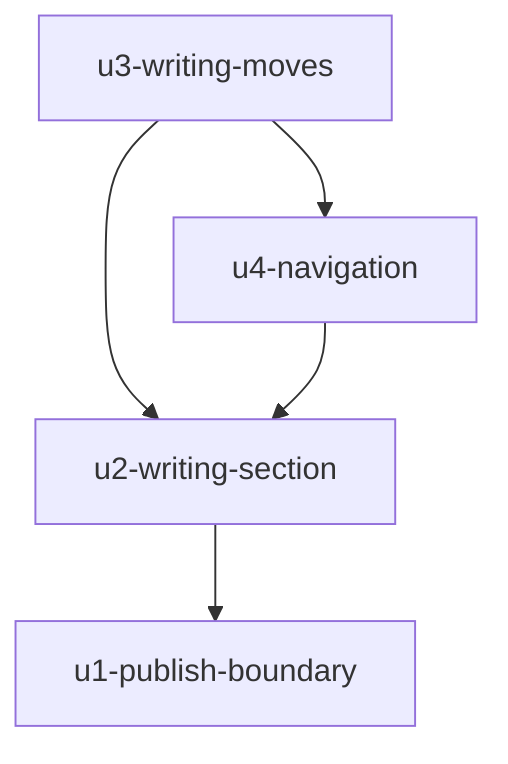

# Unit Dependencies — first release

Topology only; the build order is chosen in Delivery Planning.

## Dependency DAG



Text fallback: U2 depends on U1. U4 depends on U2. U3 depends on U2 and U4.

| Unit | Depends on | Why |
|------|-----------|-----|
| U1 | — | Changes only existing code; runs end to end on its own |
| U2 | U1 | Lists read the posts-only data and the homepage page U1 rewrites; site pages must already be excluded |
| U3 | U2, U4 | Repoints the `/writing` Tags/Graph capsules U2 creates; its "no `/tags` or `/graph` links" check needs U4's removal of those menu items, and it checks the Writing marker on the pages it moves (added in Delivery Planning Q1) |
| U4 | U2 | The bar's only item links to `/writing`, which U2 creates |

## Integration Points

| From → To | Integration | Shape |
|-----------|-------------|-------|
| U1 → U2 | Generated `content/` (post metadata with `is_hub`, no homepage artifact) read through ContentData | Files at build time |
| U1 → U2 | `index.astro` homepage opening, extended by U2 with the weekly section | Shared page file |
| U2 → U3 | `/writing` capsule targets | Link hrefs |
| U2 → U4 | `/writing` route | Link href |
| U3 → server | Redirect table in the web root | JSON file at runtime |

## Thin End-to-End Slice

U1 is first in every valid order. It changes the publishing step, the pipeline and the homepage opening together, so the fixture preprocess, the site build and all existing suites run against the new boundary before any new page exists.

## Parallel Development

- None. The DAG is a chain U1 → U2 → U4 → U3. Parallel building stays allowed in principle (Q2), but no two units are independent: U3 depends on U4 because U3's link check needs U4's menu change (Delivery Planning Q1).

## Edge Block

```yaml
units:
  - name: u1-publish-boundary
    kind: service
    depends_on: []
  - name: u2-writing-section
    kind: ui
    depends_on: [u1-publish-boundary]
  - name: u3-writing-moves
    kind: ui
    depends_on: [u2-writing-section, u4-navigation]
  - name: u4-navigation
    kind: ui
    depends_on: [u2-writing-section]
```
